# MagPress M4 — Assembly manual (Rev E)

How to build the MagPress M4 photo-magnet press from its parts, in 19 steps: frame and die table, ram and crown, toggle drive, universal die, a size kit, then set-up and tests. Every picture comes from the 3D model in [`models/`](../models/): the parts added in a step are in colour and pulled apart along the way they go in; parts already fitted are grey. Labels give the part number; the parts table under each picture gives the name, quantity and 3D file.

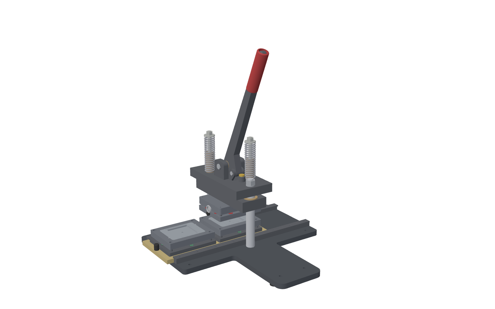

## Before you start

- **Parts.** Made parts (MP-xxx) are made to the drawing set in [`release/RevE/`](../release/RevE/); bought parts (BUY-xx) are in the BOM and in [`models/parts.csv`](../models/parts.csv). Lay every step's parts out and check them off before you start the step.
- **Directions.** Front is the operator side (the base tongue). Left and right are as seen from the front. Station A (pickup) is the left station on the die table, station B (crimp) the right. Pushing the table to the right puts station A under the ram.
- **Bushings.** The pin bushings are PTFE-composite and run dry: no grease, never ream them after pressing. Press them with a stepped mandrel, never with a hammer.
- **Lubrication.** Columns and the graphite-plugged ram bushings run dry: wipe them clean. Light oil on the rails only. No oil on the dies.
- **Threadlocker.** Clean threads with solvent before Loctite. The torque table below lists every joint.
- **Safety.** The press weighs about 48 kg: lift it with two people. The pinch points are between the dies and between the table and the stop blocks. Wear gloves when handling tin blanks: the cut edges are sharp.

> ✅ **Rev E.** Rev E makes sharp-cornered magnets with the photo carried round onto the back as a flat printed border, like bought tin photo magnets, and fixes the points found in an independent design review. The 3D check was repeated for Rev E at six handle angles and with a round kit fitted: nothing clashes. The changes, and the steps they touch:

| Part | Change | Step |
|---|---|---|
| Size kits | Sharp R1 corners. Stroke 1 folds a flat tin blank (X + 8, corners clipped 45°) round the pedestal; ring A has a stepped recess for the blank and the photo. The crimp anvil folds the edge flat under the back plate. | 17 |
| Upper die MP-201, springs | Die body 20 thick with a Ø54 counterbore for the holder; 8 red Ø12.5 × 44 springs (1.6 kN) hold the upper ring while the tin folds. | 15 |
| Plug locking pin | A Ø6 detent pin along the die body from the left end (the Rev D cross pin was blocked by the front column). | 18 |
| Crown MP-108, handle stop | Crown 120 wide (was 80). The handle stop is on its own post MP-121 on the crown, not in the column top. | 12 |
| Return springs | POM guide sleeves on the rods. | 12 |
| Screws, pads, pilot | Rail and keeper screws M5 × 30, station-base screws M5 × 20 into tapped-through bases; six pads; Ø10 station pilot in tough steel. | 3 |

> ✅ **Rev D.** Rev D adds four round size kits: Ø44, Ø50, Ø56 and Ø58 (drawings MP-223 to MP-229). They are prepared and fitted like the square kits in steps 17 and 18, with two differences: the round plug hangs on the inner holes of the die body (dowels in D2, stud in K2, the same locking pin), and round pedestals and anvils have no Ø4 anti-rotation pin. The 3D check was repeated with round kit D58 fitted in place of kit 6363: nothing clashes.

## Tools and materials

- Arbor or hydraulic press (5 t) with a flat bed, support blocks and stepped bushing mandrels for 12/14, 16/18 and 25/32 bushings
- Torque wrenches 2–25 N·m and 20–110 N·m; hex keys 2.5, 3, 4, 5, 6, 8 mm; spanners and sockets 10, 16, 17, 24 mm
- External retaining-ring pliers for Ø12 and Ø16 shafts
- Ø18 H7 line reamer with a long pilot (for the pivot cheeks)
- Straightedge, feeler gauges, 0.05 mm shim, dial indicator on a magnetic base, calipers, depth gauge, square, bore gauge
- Ø16 centring pin with a point and a Ø12 centring plug (station alignment, step 14)
- Loctite 243 (medium) and 222 (low strength), rubber adhesive, light machine oil
- Two wooden bearers about 50 mm high and a wooden block about 60 mm high
- For the tests: 10 kN load cell (20 kN for the proof load), hanging scale, dummy die block

## Torque and thread-locker table

| Joint | Fastener | Torque | Thread lock |
|---|---|---|---|
| Rail and keeper screws | M5 × 30 ISO 10642 | 6 N·m | — |
| Stop-block screws | M5 × 35 ISO 4762 | 6 N·m | Loctite 243 |
| Column clamp screws | M10 × 16 DIN 7984 | 40 N·m | Loctite 243 |
| Column nuts | M16 × 1.5 + Nord-Lock | 100 N·m, two passes | — |
| Clevis screws | M5 × 25 ISO 4762 | 6 N·m | Loctite 243 |
| Die-holder screws | M5 × 16 DIN 7984 | 6 N·m | Loctite 243 |
| Station pilot | M6 | hand tight | Loctite 243 |
| Return rods into the ram | M10 | 20 N·m * | Loctite 243 |
| Bumpers | M6 stud | hand tight | Loctite 243 |
| Cheek screws | M8 × 30 + Nord-Lock | 25 N·m * | — |
| Return-spring nuts | M10 nylock | to 109.5 mm spring length | — |
| Shank into the die body | M10 | 25 N·m * | Loctite 243 |
| Die-holder lock screw | M5 cone point | about 3 N·m | nylon patch |
| Station-base screws | M5 × 20 ISO 10642 | 6 N·m | — |
| Handle-stop post | M10 stud | 40 N·m | Loctite 243 |
| Carrier shoulder screws | ISO 7379 Ø6 | 8 N·m | — |
| Plug stud | M6 | 8 N·m * | Loctite 243 |
| Table stop pin | M4 | 2.5 N·m * | Loctite 243 |
| Stop screws | M6 × 0.75 × 40 + lock nut | set, then lock | — |
| Handle-stop screw | M10 × 1 × 12 | set to the 3° rest | nylon patch |
| Ball plunger, ring plungers | M6, M3 | set, then lock | Loctite 222 |
| Ring thumb screws | M5 dog point | finger tight | — |

Values marked * are standard values for property class 8.8 screws; the others are from the drawings and the build pack.

## Part A — Frame and die table

### Step 1 — Prepare the base plate

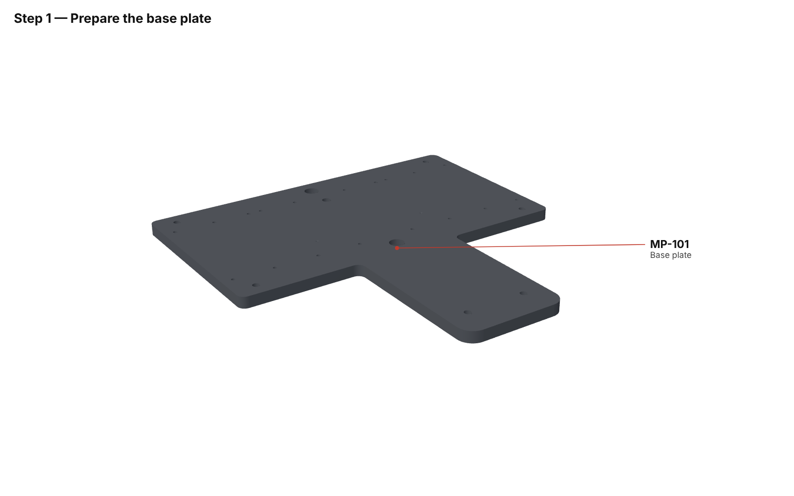

| Part | Name | Qty | 3D model |
|---|---|---|---|
| MP-101 | Base plate | 1 | [STEP](../models/step/MP-101_base-plate.step) · [STL](../models/stl/MP-101_base-plate.stl) |

**Tools:** Straightedge, feeler gauges, bore gauge, two wooden bearers about 50 mm high

1. Deburr and clean the plate. Check the counterbores C1/C2 (Ø33 × 8.5) are on the underside and the tongue is at the front.
2. Check flatness of the slide area (X ±230 × Y ±75): 0.05 mm with a straightedge and feelers.
3. Check the column holes C1/C2: Ø20 H7, 210.00 ±0.01 apart.
4. Put the plate on two wooden bearers for the rest of the build, so you can reach the screws underneath.

> ✅ **Check.** Flat within 0.05 mm under the die table; column holes to size and position.

### Step 2 — Columns

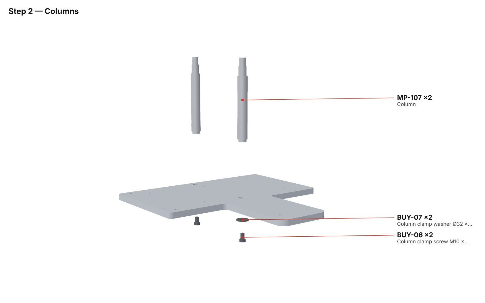

| Part | Name | Qty | 3D model |
|---|---|---|---|
| MP-107 | Column | 2 | [STEP](../models/step/MP-107_column.step) · [STL](../models/stl/MP-107_column.stl) |
| BUY-07 | Column clamp washer Ø32 × 2.5, hardened | 2 | [STEP](../models/step/BUY-07_column-clamp-washer-d32-x-2-5-hardened.step) · [STL](../models/stl/BUY-07_column-clamp-washer-d32-x-2-5-hardened.stl) |
| BUY-06 | Column clamp screw M10 × 16 DIN 7984 (low head) | 2 | [STEP](../models/step/BUY-06_column-clamp-screw-m10-x-16-din-7984-low-head.step) · [STL](../models/stl/BUY-06_column-clamp-screw-m10-x-16-din-7984-low-head.stl) |

**Tools:** Arbor or hydraulic press (5 t), flat support block, square, dial indicator, torque wrench, 8 mm hex key, Loctite 243

1. Support the base on the press bed directly under the first hole.
2. Press the column's Ø20 p6 spigot (the short end) into C1 from the top until the Ø25 shoulder seats on the plate. Press straight; a light oil film on the spigot helps.
3. Repeat for the second column in C2.
4. From underneath, fit the hardened Ø32 × 2.5 washer into each counterbore and pull the column down with the M10 × 16 low-head clamp screw, Loctite 243, 40 N·m. The head ends flush with the base underside.

> ✅ **Check.** Each column square to the base within 0.05 per 100 mm; centres 210.00 ±0.01 at the top.

### Step 3 — Die table on the bench

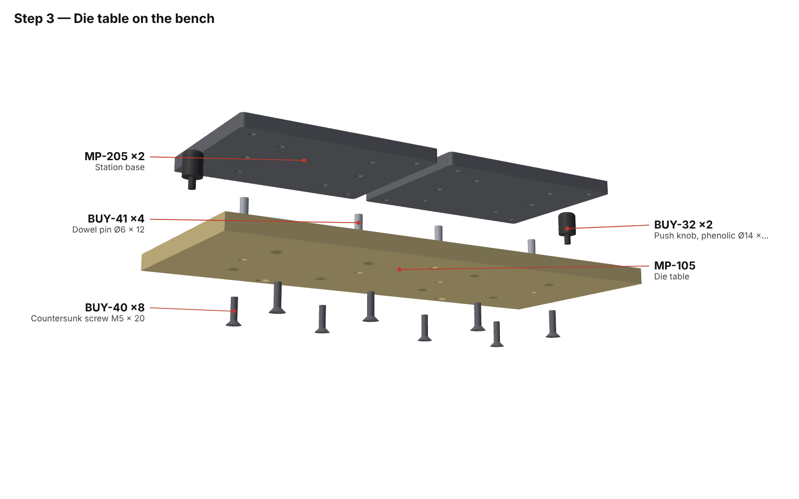

| Part | Name | Qty | 3D model |
|---|---|---|---|
| MP-105 | Die table (slide) | 1 | [STEP](../models/step/MP-105_die-table-slide.step) · [STL](../models/stl/MP-105_die-table-slide.stl) |
| BUY-41 | Dowel pin Ø6 × 12 (station bases) | 4 | [STEP](../models/step/BUY-41_dowel-pin-d6-x-12-station-bases.step) · [STL](../models/stl/BUY-41_dowel-pin-d6-x-12-station-bases.stl) |
| MP-205 | Station base (universal) | 2 | [STEP](../models/step/MP-205_station-base-universal.step) · [STL](../models/stl/MP-205_station-base-universal.stl) |
| BUY-40 | Countersunk screw M5 × 20 ISO 10642 (station bases) | 8 | [STEP](../models/step/BUY-40_countersunk-screw-m5-x-20-iso-10642-station-bases.step) · [STL](../models/stl/BUY-40_countersunk-screw-m5-x-20-iso-10642-station-bases.stl) |
| BUY-32 | Push knob, phenolic Ø14 × 18, M5 | 2 | [STEP](../models/step/BUY-32_push-knob-phenolic-d14-x-18-m5.step) · [STL](../models/stl/BUY-32_push-knob-phenolic-d14-x-18-m5.stl) |

**Tools:** Soft-face mallet, 3 mm hex key, torque wrench

1. The station bases go on now because their screws are under the table.
2. Press two Ø6 × 12 dowels into each pair of G holes in the table top, 6 mm proud.
3. Put a station base (MP-205) on each pair of dowels: base A over the left station, base B over the right. The Ø4 hole Q in each base goes to the front.
4. From underneath, fit the eight M5 × 20 countersunk screws (F1 to F8) flush, 6 N·m. The holes in the bases are tapped right through.
5. Screw the two Ø14 push knobs into the M5 holes K1/K2 on the table top, one at each end.

> ✅ **Check.** Screw heads flush or below the table underside; bases sit flat on the table.

### Step 4 — Guide rails, keepers and the die table

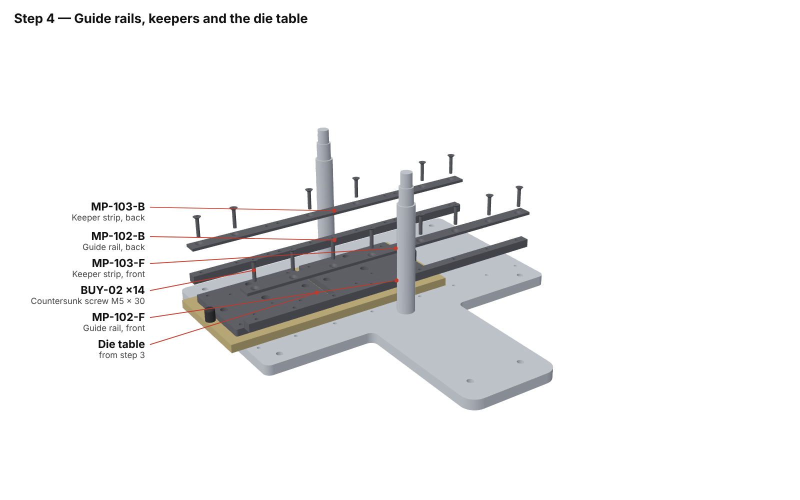

| Part | Name | Qty | 3D model |
|---|---|---|---|
| — | Die table from step 3 |  |  |
| MP-102-F | Guide rail, front | 1 | [STEP](../models/step/MP-102-F_guide-rail-front.step) · [STL](../models/stl/MP-102-F_guide-rail-front.stl) |
| MP-102-B | Guide rail, back | 1 | [STEP](../models/step/MP-102-B_guide-rail-back.step) · [STL](../models/stl/MP-102-B_guide-rail-back.stl) |
| MP-103-F | Keeper strip, front | 1 | [STEP](../models/step/MP-103-F_keeper-strip-front.step) · [STL](../models/stl/MP-103-F_keeper-strip-front.stl) |
| MP-103-B | Keeper strip, back | 1 | [STEP](../models/step/MP-103-B_keeper-strip-back.step) · [STL](../models/stl/MP-103-B_keeper-strip-back.stl) |
| BUY-02 | Countersunk screw M5 × 30 ISO 10642 | 14 | [STEP](../models/step/BUY-02_countersunk-screw-m5-x-30-iso-10642.step) · [STL](../models/stl/BUY-02_countersunk-screw-m5-x-30-iso-10642.stl) |

**Tools:** 0.05 mm shim, 3 mm hex key, torque wrench, light oil

1. Lay the front rail (-F, 8 holes) and the back rail (-B, 10 holes) on the base over the rail screw holes.
2. Put the die table between them as a gauge, with a 0.05 mm shim between the table and one rail.
3. Lay the keepers on the rails with the hole line toward the outside, so the inner edge overlaps the table by 5 mm: front keeper (-F) at the front, back keeper (-B, with four plain holes) at the back.
4. Fit the fourteen M5 × 30 countersunk screws through keeper and rail into the base, 6 N·m, working from the centre out; the heads end just below the keeper top. Leave the four plain holes in the back keeper for the stop blocks.
5. Pull out the shim. Put a few drops of light oil on the rails.

> ✅ **Check.** The table runs end to end with fingertip force, with no rock and no lift at the ends; running clearance 0.03 to 0.05 mm.

### Step 5 — Stop blocks, stop pin and ball plunger

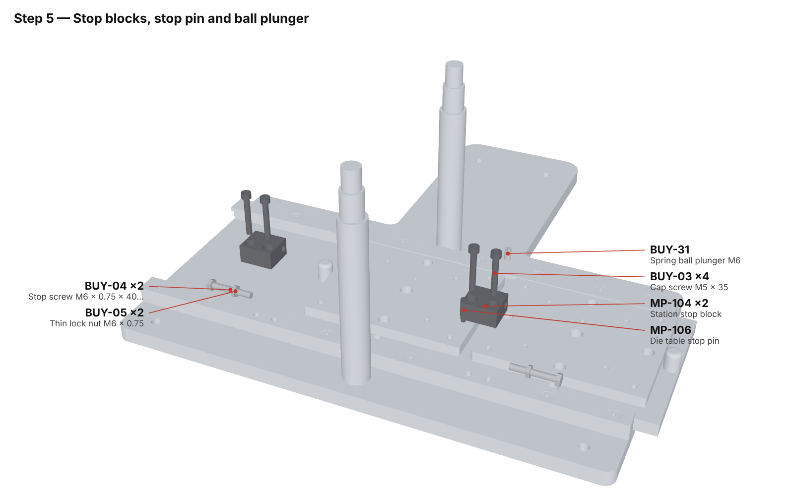

| Part | Name | Qty | 3D model |
|---|---|---|---|
| MP-104 | Station stop block | 2 | [STEP](../models/step/MP-104_station-stop-block.step) · [STL](../models/stl/MP-104_station-stop-block.stl) |
| BUY-03 | Cap screw M5 × 35 ISO 4762 (stop blocks) | 4 | [STEP](../models/step/BUY-03_cap-screw-m5-x-35-iso-4762-stop-blocks.step) · [STL](../models/stl/BUY-03_cap-screw-m5-x-35-iso-4762-stop-blocks.stl) |
| BUY-04 | Stop screw M6 × 0.75 × 40 hex | 2 | [STEP](../models/step/BUY-04_stop-screw-m6-x-0-75-x-40-hex.step) · [STL](../models/stl/BUY-04_stop-screw-m6-x-0-75-x-40-hex.stl) |
| BUY-05 | Thin lock nut M6 × 0.75 | 2 | [STEP](../models/step/BUY-05_thin-lock-nut-m6-x-0-75.step) · [STL](../models/stl/BUY-05_thin-lock-nut-m6-x-0-75.stl) |
| MP-106 | Die table stop pin | 1 | [STEP](../models/step/MP-106_die-table-stop-pin.step) · [STL](../models/stl/MP-106_die-table-stop-pin.stl) |
| BUY-31 | Spring ball plunger M6 | 1 | [STEP](../models/step/BUY-31_spring-ball-plunger-m6.step) · [STL](../models/stl/BUY-31_spring-ball-plunger-m6.stl) |

**Tools:** 4 mm hex key, 10 mm spanner, screwdriver, torque wrench, Loctite 243 and 222

1. Put a stop block (MP-104) over each pair of plain holes in the back keeper, the overhang toward the table.
2. Fit two M5 × 35 cap screws per block through keeper and rail into the base, Loctite 243, 6 N·m.
3. Screw an M6 × 0.75 × 40 stop screw with its lock nut into each block from the outside, tip toward the centre. Leave the lock nuts loose: the stations are set in step 14.
4. Screw the stop pin (MP-106) into hole S on the table top, Loctite 243, 2.5 N·m.
5. Screw the ball plunger into hole BP from the top until it clicks into the detent spots at both stations. Lock it with Loctite 222.

> ✅ **Check.** The table clicks at both stations and the stop pin meets a stop screw at each end.

## Part B — Ram and crown

### Step 6 — Ram sub-assembly

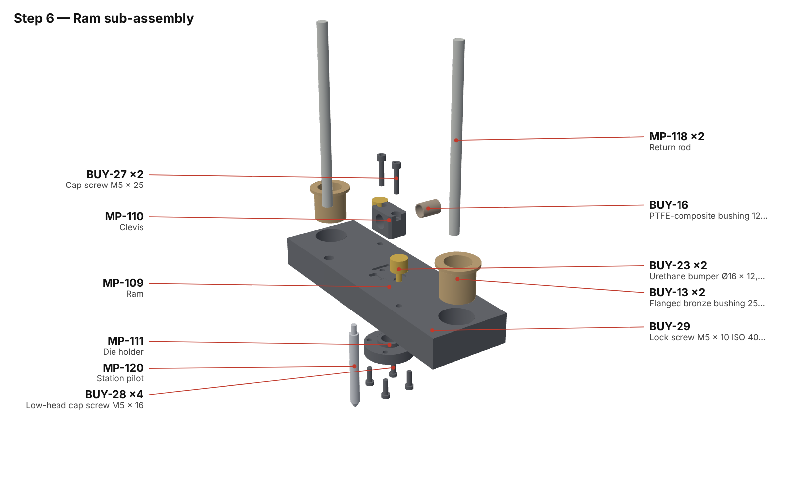

| Part | Name | Qty | 3D model |
|---|---|---|---|
| MP-109 | Ram | 1 | [STEP](../models/step/MP-109_ram.step) · [STL](../models/stl/MP-109_ram.stl) |
| BUY-13 | Flanged bronze bushing 25 × 32 × 33 (ram) | 2 | [STEP](../models/step/BUY-13_flanged-bronze-bushing-25-x-32-x-33-ram.step) · [STL](../models/stl/BUY-13_flanged-bronze-bushing-25-x-32-x-33-ram.stl) |
| MP-110 | Clevis | 1 | [STEP](../models/step/MP-110_clevis.step) · [STL](../models/stl/MP-110_clevis.stl) |
| BUY-16 | PTFE-composite bushing 12 × 14 × 20 (lever A, clevis) | 1 | [STEP](../models/step/BUY-16_ptfe-composite-bushing-12-x-14-x-20-lever-a-clevis.step) · [STL](../models/stl/BUY-16_ptfe-composite-bushing-12-x-14-x-20-lever-a-clevis.stl) |
| BUY-27 | Cap screw M5 × 25 ISO 4762 (clevis) | 2 | [STEP](../models/step/BUY-27_cap-screw-m5-x-25-iso-4762-clevis.step) · [STL](../models/stl/BUY-27_cap-screw-m5-x-25-iso-4762-clevis.stl) |
| MP-111 | Die holder | 1 | [STEP](../models/step/MP-111_die-holder.step) · [STL](../models/stl/MP-111_die-holder.stl) |
| BUY-28 | Low-head cap screw M5 × 16 DIN 7984 (die holder) | 4 | [STEP](../models/step/BUY-28_low-head-cap-screw-m5-x-16-din-7984-die-holder.step) · [STL](../models/stl/BUY-28_low-head-cap-screw-m5-x-16-din-7984-die-holder.stl) |
| BUY-29 | Lock screw M5 × 10 ISO 4027, cone point (die holder) | 1 | [STEP](../models/step/BUY-29_lock-screw-m5-x-10-iso-4027-cone-point-die-holder.step) · [STL](../models/stl/BUY-29_lock-screw-m5-x-10-iso-4027-cone-point-die-holder.stl) |
| MP-120 | Station pilot | 1 | [STEP](../models/step/MP-120_station-pilot.step) · [STL](../models/stl/MP-120_station-pilot.stl) |
| MP-118 | Return rod | 2 | [STEP](../models/step/MP-118_return-rod.step) · [STL](../models/stl/MP-118_return-rod.stl) |
| BUY-23 | Urethane bumper Ø16 × 12, M6 stud | 2 | [STEP](../models/step/BUY-23_urethane-bumper-d16-x-12-m6-stud.step) · [STL](../models/stl/BUY-23_urethane-bumper-d16-x-12-m6-stud.stl) |

**Tools:** Press and stepped mandrels (25/32 and 12/14 bushings), 3 and 4 mm hex keys, 17 mm spanner, torque wrench, Loctite 243

1. Press the two flanged bronze bushings into the ram's Ø32 bores from the top, flange on the top face, flush with the underside.
2. Press the 12 × 14 × 20 PTFE-composite bushing into the clevis bore, flush both sides. Never ream or grease these bushings.
3. Check the two link-clearance pockets L1/L2 beside the clevis pocket are clean and deburred: the links' lower ends run in them. Put the clevis in the 2 mm pocket on the ram top, bore running left to right. Fit two M5 × 25 cap screws, Loctite 243, 6 N·m.
4. Push the die holder's Ø24 spigot into the ram underside, its Ø4 orientation hole to the front. Fit four M5 × 16 low-head screws from below, Loctite 243, 6 N·m. Screw the M5 cone-point lock screw into the holder's side hole and back it off.
5. Push the station pilot's Ø10 body into hole PL under the ram (back side) and screw it home, Loctite 243 on the M6 thread. The tip ends 84 mm below the ram.
6. Screw the two return rods into R1/R2 on the ram top with a spanner on their flats, Loctite 243, 20 N·m.
7. Screw the two urethane bumpers into U1/U2 on the ram top, Loctite 243, hand tight.

> ✅ **Check.** Clevis bore parallel to the ram underside within 0.02; pilot square to the ram.

### Step 7 — Crown sub-assembly

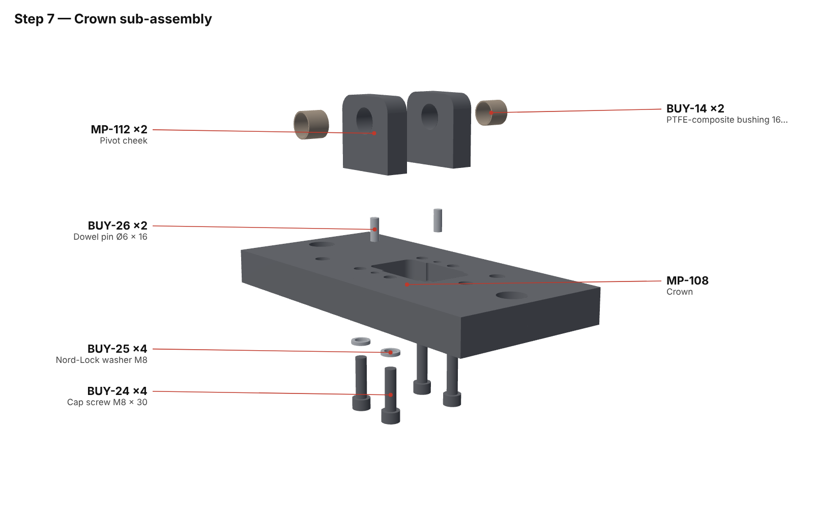

| Part | Name | Qty | 3D model |
|---|---|---|---|
| MP-108 | Crown | 1 | [STEP](../models/step/MP-108_crown.step) · [STL](../models/stl/MP-108_crown.stl) |
| BUY-26 | Dowel pin Ø6 × 16 (cheeks) | 2 | [STEP](../models/step/BUY-26_dowel-pin-d6-x-16-cheeks.step) · [STL](../models/stl/BUY-26_dowel-pin-d6-x-16-cheeks.stl) |
| MP-112 | Pivot cheek | 2 | [STEP](../models/step/MP-112_pivot-cheek.step) · [STL](../models/stl/MP-112_pivot-cheek.stl) |
| BUY-14 | PTFE-composite bushing 16 × 18 × 15 (cheeks) | 2 | [STEP](../models/step/BUY-14_ptfe-composite-bushing-16-x-18-x-15-cheeks.step) · [STL](../models/stl/BUY-14_ptfe-composite-bushing-16-x-18-x-15-cheeks.stl) |
| BUY-25 | Nord-Lock washer M8 | 4 | [STEP](../models/step/BUY-25_nord-lock-washer-m8.step) · [STL](../models/stl/BUY-25_nord-lock-washer-m8.stl) |
| BUY-24 | Cap screw M8 × 30 ISO 4762 (cheeks) | 4 | [STEP](../models/step/BUY-24_cap-screw-m8-x-30-iso-4762-cheeks.step) · [STL](../models/stl/BUY-24_cap-screw-m8-x-30-iso-4762-cheeks.stl) |

**Tools:** Ø18 H7 line reamer with pilot, press and 16/18 mandrel, 6 mm hex key, torque wrench

1. Deburr the four reliefs in the slot walls (N1/N2 underneath, N3/N4 on top): the ends of pins B and A pass through them.
2. Press the two Ø6 × 16 dowels into P1/P2 on the crown top, 8 mm proud.
3. Put a pivot cheek on each dowel, the bore running left to right. Fix each with two M8 × 30 cap screws and Nord-Lock washers from below, 25 N·m.
4. Line-ream both cheek bores together to Ø18 H7 in one pass.
5. Press a 16 × 18 × 15 PTFE-composite bushing into each cheek, 0.5 mm in from each face. Do not ream the bushings afterwards.

> ✅ **Check.** A Ø16 g6 test pin slides through both cheeks freely with no binding.

### Step 8 — Ram and crown onto the columns

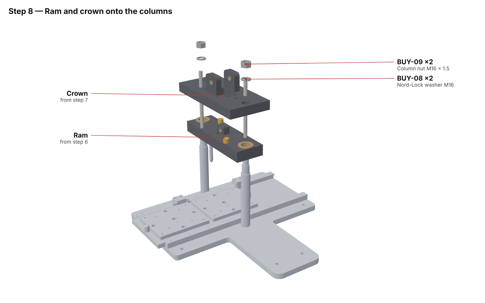

| Part | Name | Qty | 3D model |
|---|---|---|---|
| — | Ram sub-assembly from step 6 |  |  |
| — | Crown sub-assembly from step 7 |  |  |
| BUY-08 | Nord-Lock washer M16 | 2 | [STEP](../models/step/BUY-08_nord-lock-washer-m16.step) · [STL](../models/stl/BUY-08_nord-lock-washer-m16.stl) |
| BUY-09 | Column nut M16 × 1.5 | 2 | [STEP](../models/step/BUY-09_column-nut-m16-x-1-5.step) · [STL](../models/stl/BUY-09_column-nut-m16-x-1-5.stl) |

**Tools:** 24 mm socket, torque wrench (100 N·m), wooden block about 60 mm high

1. Wipe the columns clean and dry: the graphite-plugged bushings run without grease.
2. Slide the ram down over the column tops, bushing flanges up. Let it rest low on a wooden block on the die table.
3. Lower the crown over the column spigots, cheeks on top, with the return rods passing up through holes R1/R2.
4. Fit a Nord-Lock washer pair and an M16 × 1.5 nut on each column. Tighten to 100 N·m in two passes, alternating.

> ✅ **Check.** The ram slides the full column length under its own weight. If it binds, loosen the nuts and re-seat the crown.

## Part C — Toggle drive

### Step 9 — Lever and links on the bench

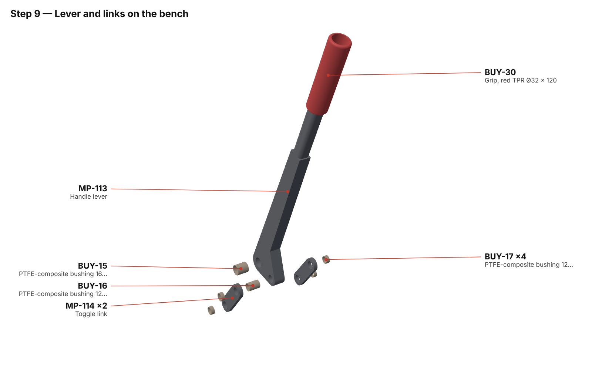

| Part | Name | Qty | 3D model |
|---|---|---|---|
| MP-113 | Handle lever (one piece) | 1 | [STEP](../models/step/MP-113_handle-lever-one-piece.step) · [STL](../models/stl/MP-113_handle-lever-one-piece.stl) |
| BUY-15 | PTFE-composite bushing 16 × 18 × 20 (lever O) | 1 | [STEP](../models/step/BUY-15_ptfe-composite-bushing-16-x-18-x-20-lever-o.step) · [STL](../models/stl/BUY-15_ptfe-composite-bushing-16-x-18-x-20-lever-o.stl) |
| BUY-16 | PTFE-composite bushing 12 × 14 × 20 (lever A, clevis) | 1 | [STEP](../models/step/BUY-16_ptfe-composite-bushing-12-x-14-x-20-lever-a-clevis.step) · [STL](../models/stl/BUY-16_ptfe-composite-bushing-12-x-14-x-20-lever-a-clevis.stl) |
| BUY-30 | Grip, red TPR Ø32 × 120 | 1 | [STEP](../models/step/BUY-30_grip-red-tpr-d32-x-120.step) · [STL](../models/stl/BUY-30_grip-red-tpr-d32-x-120.stl) |
| MP-114 | Toggle link | 2 | [STEP](../models/step/MP-114_toggle-link.step) · [STL](../models/stl/MP-114_toggle-link.stl) |
| BUY-17 | PTFE-composite bushing 12 × 14 × 6 (links) | 4 | [STEP](../models/step/BUY-17_ptfe-composite-bushing-12-x-14-x-6-links.step) · [STL](../models/stl/BUY-17_ptfe-composite-bushing-12-x-14-x-6-links.stl) |

**Tools:** Press and 16/18 and 12/14 mandrels, rubber adhesive

1. Press the 16 × 18 × 20 bushing into the lever's pivot bore O and the 12 × 14 × 20 bushing into the crank bore A, flush both faces.
2. Push the red grip onto the grip zone with rubber adhesive, centred 320 mm from O (it covers 260 to 380).
3. Press a 12 × 14 × 6 bushing into each bore of both links, flush with the outer face. The links are a matched pair: keep their stamp marks together and facing out.

> ✅ **Check.** Pins slide through every bushing by hand with no play you can feel.

### Step 10 — Hang the lever on pin O

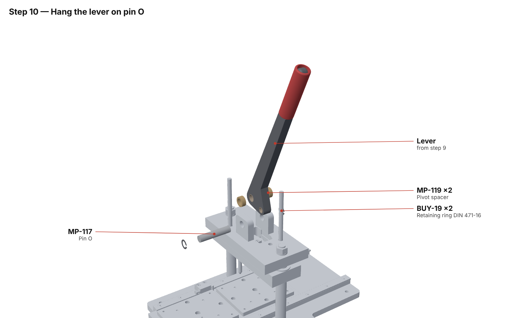

| Part | Name | Qty | 3D model |
|---|---|---|---|
| — | Lever from step 9 |  |  |
| MP-119 | Pivot spacer | 2 | [STEP](../models/step/MP-119_pivot-spacer.step) · [STL](../models/stl/MP-119_pivot-spacer.stl) |
| MP-117 | Pin O (handle pivot) | 1 | [STEP](../models/step/MP-117_pin-o-handle-pivot.step) · [STL](../models/stl/MP-117_pin-o-handle-pivot.stl) |
| BUY-19 | Retaining ring DIN 471-16 | 2 | [STEP](../models/step/BUY-19_retaining-ring-din-471-16.step) · [STL](../models/stl/BUY-19_retaining-ring-din-471-16.stl) |

**Tools:** External retaining-ring pliers (Ø16)

1. Hold the lever between the cheeks, handle pointing to the front, with a bronze spacer each side of it.
2. Push pin O through: left cheek, spacer, lever, spacer, right cheek.
3. Fit a DIN 471-16 retaining ring in the groove at each end.

> ✅ **Check.** The lever swings freely through its whole arc; end float 0.1 to 0.5 mm.

### Step 11 — Links, pin A and pin B

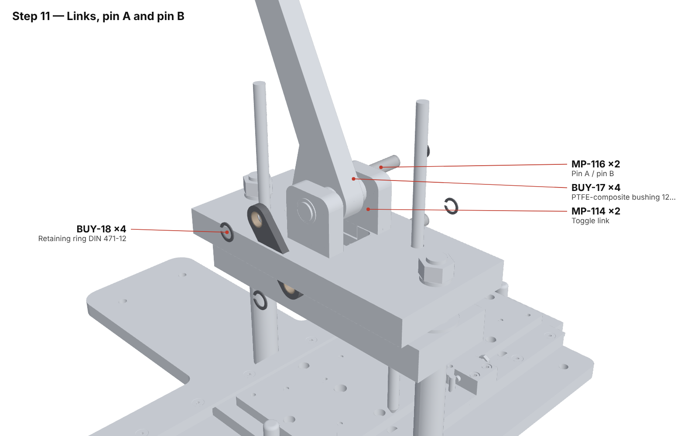

| Part | Name | Qty | 3D model |
|---|---|---|---|
| MP-114 | Toggle link | 2 | [STEP](../models/step/MP-114_toggle-link.step) · [STL](../models/stl/MP-114_toggle-link.stl) |
| BUY-17 | PTFE-composite bushing 12 × 14 × 6 (links) | 4 | [STEP](../models/step/BUY-17_ptfe-composite-bushing-12-x-14-x-6-links.step) · [STL](../models/stl/BUY-17_ptfe-composite-bushing-12-x-14-x-6-links.stl) |
| MP-116 | Pin A / pin B (toggle) | 2 | [STEP](../models/step/MP-116_pin-a-pin-b-toggle.step) · [STL](../models/stl/MP-116_pin-a-pin-b-toggle.stl) |
| BUY-18 | Retaining ring DIN 471-12 | 4 | [STEP](../models/step/BUY-18_retaining-ring-din-471-12.step) · [STL](../models/stl/BUY-18_retaining-ring-din-471-12.stl) |

**Tools:** External retaining-ring pliers (Ø12)

1. Put a link each side of the lever at the crank bore A, stamp marks out. Push pin A through and fit a DIN 471-12 ring at each end.
2. With the ram still resting low, swing the links down either side of the clevis. Raise the ram until the bores line up and push pin B through link, clevis and link.
3. Fit a DIN 471-12 ring at each end of pin B. Pin B can only go in with the ram low: with the handle up its ends sit in the crown reliefs.

> ✅ **Check.** Lifting the handle lifts the ram smoothly; nothing touches the crown or the ram top through the full stroke.

### Step 12 — Return springs and handle stop

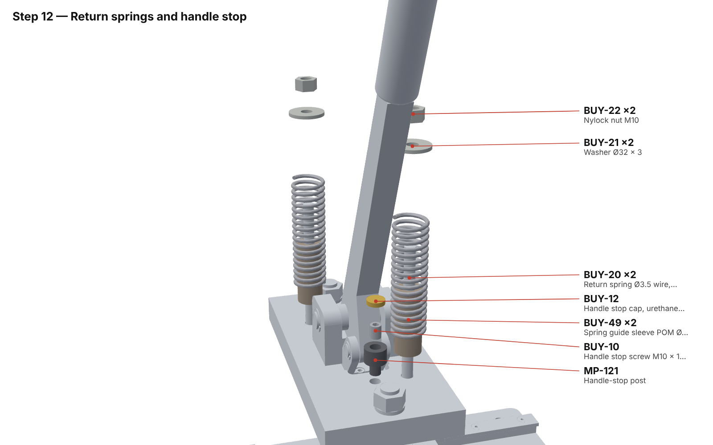

| Part | Name | Qty | 3D model |
|---|---|---|---|
| BUY-49 | Spring guide sleeve POM Ø24 × Ø10.5 × 60 (return rod) | 2 | [STEP](../models/step/BUY-49_spring-guide-sleeve-pom-d24-x-d10-5-x-60-return-rod.step) · [STL](../models/stl/BUY-49_spring-guide-sleeve-pom-d24-x-d10-5-x-60-return-rod.stl) |
| BUY-20 | Return spring Ø3.5 wire, OD 31.5 (shown installed, 109.5) | 2 | [STEP](../models/step/BUY-20_return-spring-d3-5-wire-od-31-5-shown-installed-109-5.step) · [STL](../models/stl/BUY-20_return-spring-d3-5-wire-od-31-5-shown-installed-109-5.stl) |
| BUY-21 | Washer Ø32 × 3 (return rod) | 2 | [STEP](../models/step/BUY-21_washer-d32-x-3-return-rod.step) · [STL](../models/stl/BUY-21_washer-d32-x-3-return-rod.stl) |
| BUY-22 | Nylock nut M10 | 2 | [STEP](../models/step/BUY-22_nylock-nut-m10.step) · [STL](../models/stl/BUY-22_nylock-nut-m10.stl) |
| MP-121 | Handle-stop post | 1 | [STEP](../models/step/MP-121_handle-stop-post.step) · [STL](../models/stl/MP-121_handle-stop-post.stl) |
| BUY-10 | Handle stop screw M10 × 1 × 12, nylon patch (set screw) | 1 | [STEP](../models/step/BUY-10_handle-stop-screw-m10-x-1-x-12-nylon-patch-set-screw.step) · [STL](../models/stl/BUY-10_handle-stop-screw-m10-x-1-x-12-nylon-patch-set-screw.stl) |
| BUY-12 | Handle stop cap, urethane Ø16 × 4 | 1 | [STEP](../models/step/BUY-12_handle-stop-cap-urethane-d16-x-4.step) · [STL](../models/stl/BUY-12_handle-stop-cap-urethane-d16-x-4.stl) |

**Tools:** 17 mm socket, 5 mm hex key, 17 mm spanner, torque wrench, calipers, protractor or angle gauge, Loctite 243

1. Take the wooden block out. Slide a POM guide sleeve over each return rod down onto the crown, then drop a return spring over it, then a Ø32 × 3 washer and an M10 nylock nut.
2. Tighten each nut until the ram is pulled up against the bumpers and the spring measures 109.5 mm (about 80 N).
3. Screw the handle-stop post (MP-121) into hole T on the crown top, 62 mm in front of the centre, Loctite 243, 40 N·m. Screw the M10 × 1 × 12 stop screw (nylon patch) into the post and put the urethane cap on it.
4. Pull the handle down onto the stop. Adjust the screw until the lever rests 3° above horizontal; the nylon patch holds the setting.

> ✅ **Check.** Handle swings 65° to 3° and springs back to the open stop from fully down, 20 times out of 20. Ram travel 38.9 ±0.3 mm.

## Part D — Universal die

### Step 13 — Lower dies

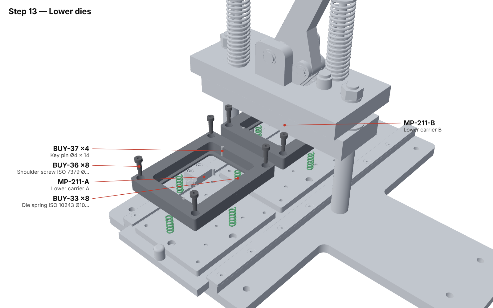

| Part | Name | Qty | 3D model |
|---|---|---|---|
| BUY-33 | Die spring ISO 10243 Ø10 × 32 green (light), shown installed 30 | 8 | [STEP](../models/step/BUY-33_die-spring-iso-10243-d10-x-32-green-light-shown-installed-30.step) · [STL](../models/stl/BUY-33_die-spring-iso-10243-d10-x-32-green-light-shown-installed-30.stl) |
| MP-211-A | Lower carrier A (universal, pickup) | 1 | [STEP](../models/step/MP-211-A_lower-carrier-a-universal-pickup.step) · [STL](../models/stl/MP-211-A_lower-carrier-a-universal-pickup.stl) |
| BUY-37 | Key pin Ø4 × 14 | 4 | [STEP](../models/step/BUY-37_key-pin-d4-x-14.step) · [STL](../models/stl/BUY-37_key-pin-d4-x-14.stl) |
| MP-211-B | Lower carrier B (universal, crimp) | 1 | [STEP](../models/step/MP-211-B_lower-carrier-b-universal-crimp.step) · [STL](../models/stl/MP-211-B_lower-carrier-b-universal-crimp.stl) |
| BUY-36 | Shoulder screw ISO 7379 Ø6 × 12 (lower carriers) | 8 | [STEP](../models/step/BUY-36_shoulder-screw-iso-7379-d6-x-12-lower-carriers.step) · [STL](../models/stl/BUY-36_shoulder-screw-iso-7379-d6-x-12-lower-carriers.stl) |

**Tools:** 5 mm hex key, torque wrench

1. Check the key pins are pressed flush in each carrier: carrier A (green band) has them at KA, carrier B (red band) at KB.
2. Put four green die springs in the pockets of each station base.
3. Lay carrier A on the left station and carrier B on the right, spring pockets down over the springs.
4. Fit four Ø6 × 12 shoulder screws through each carrier into its base, 8 N·m, in a cross pattern.

> ✅ **Check.** Each carrier moves 8 mm freely and springs back square.

### Step 14 — Align the stations

**Tools:** Ø16 centring pin with a point (fits the die holder), Ø12 centring plug (fits hole C), 10 mm spanner, dial indicator

1. Do this before the upper die goes on: the die holder must be empty.
2. Put the Ø16 centring pin in the die holder and lock it with the holder's cone-point screw. Put the Ø12 plug in hole C of station base A.
3. Push the table to the right until it clicks (station A under the ram). Lower the handle slowly and adjust the right-hand stop screw until the pin point lands on the plug centre. Lock the nut.
4. Push the table to the left (station B under the ram) and set the left-hand stop screw the same way.
5. Rev E: then back each stop screw off 0.4 of a turn (0.3 mm) before you lock it, so the table stops just past its station and the pilot always pulls it back onto the station.
6. Move the table 3 mm off a station and make a slow stroke: the station pilot must land on the table and stop the stroke. Repeat at the other station.

> ✅ **Check.** ±0.05 mm at both stations; off station the stroke stops with the dies at least 5 mm apart.

### Step 15 — Upper die on the bench

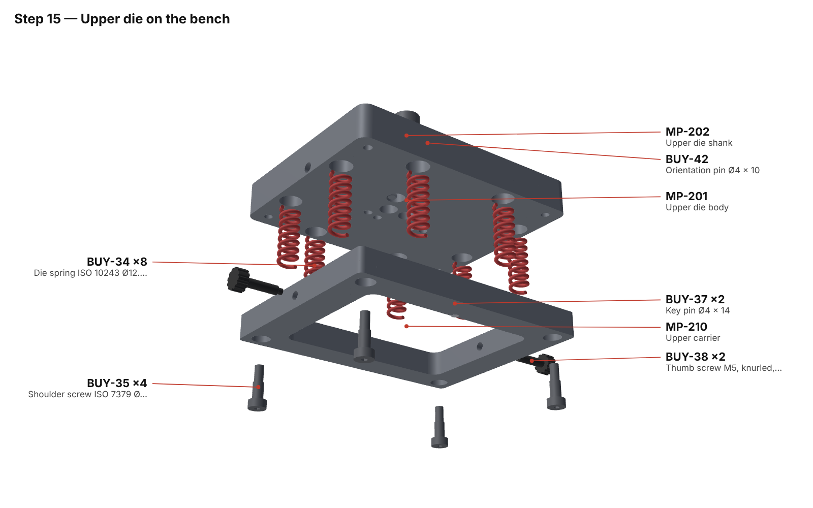

| Part | Name | Qty | 3D model |
|---|---|---|---|
| MP-201 | Upper die body (universal) | 1 | [STEP](../models/step/MP-201_upper-die-body-universal.step) · [STL](../models/stl/MP-201_upper-die-body-universal.stl) |
| MP-202 | Upper die shank (universal) | 1 | [STEP](../models/step/MP-202_upper-die-shank-universal.step) · [STL](../models/stl/MP-202_upper-die-shank-universal.stl) |
| BUY-42 | Orientation pin Ø4 × 10 | 1 | [STEP](../models/step/BUY-42_orientation-pin-d4-x-10.step) · [STL](../models/stl/BUY-42_orientation-pin-d4-x-10.stl) |
| BUY-34 | Die spring ISO 10243 Ø12.5 × 44 red (heavy), shown installed 36 | 8 | [STEP](../models/step/BUY-34_die-spring-iso-10243-d12-5-x-44-red-heavy-shown-installed-36.step) · [STL](../models/stl/BUY-34_die-spring-iso-10243-d12-5-x-44-red-heavy-shown-installed-36.stl) |
| MP-210 | Upper carrier (universal) | 1 | [STEP](../models/step/MP-210_upper-carrier-universal.step) · [STL](../models/stl/MP-210_upper-carrier-universal.stl) |
| BUY-37 | Key pin Ø4 × 14 | 2 | [STEP](../models/step/BUY-37_key-pin-d4-x-14.step) · [STL](../models/stl/BUY-37_key-pin-d4-x-14.stl) |
| BUY-38 | Thumb screw M5, knurled, dog point Ø3.5 × 3 (upper ring) | 2 | [STEP](../models/step/BUY-38_thumb-screw-m5-knurled-dog-point-d3-5-x-3-upper-ring.step) · [STL](../models/stl/BUY-38_thumb-screw-m5-knurled-dog-point-d3-5-x-3-upper-ring.stl) |
| BUY-35 | Shoulder screw ISO 7379 Ø6 × 10 (upper carrier) | 4 | [STEP](../models/step/BUY-35_shoulder-screw-iso-7379-d6-x-10-upper-carrier.step) · [STL](../models/stl/BUY-35_shoulder-screw-iso-7379-d6-x-10-upper-carrier.stl) |

**Tools:** 16 mm spanner on the shank flats or soft jaws, 5 mm hex key, torque wrench, Loctite 243, a block with a Ø20 hole, a vise or the press to compress the springs

1. Screw the shank (MP-202) into the M10 hole in the floor of the counterbore on the die body top, Loctite 243, until the Ø16 face seats: 25 N·m. Its Ø12 spigot locates it.
2. Press the Ø4 × 10 orientation pin into hole O in the counterbore floor, 4 mm proud.
3. Check the two key pins are flush in the upper carrier. Screw the two dog-point thumb screws into the carrier ends and back them out of the pocket.
4. Turn the body over onto the block (shank down through the hole). Put the eight red Ø12.5 × 44 die springs in its spring pockets.
5. Lay the carrier on the springs, pocket side up. The springs push back with about 1.6 kN, so press the carrier down onto the body in a vise or under the press first. Fit the four Ø6 × 10 shoulder screws through the carrier into the body, then release slowly. Finish at 8 N·m.

> ✅ **Check.** The carrier pushes up 5.5 mm evenly and springs back square to the body.

### Step 16 — Mount the upper die

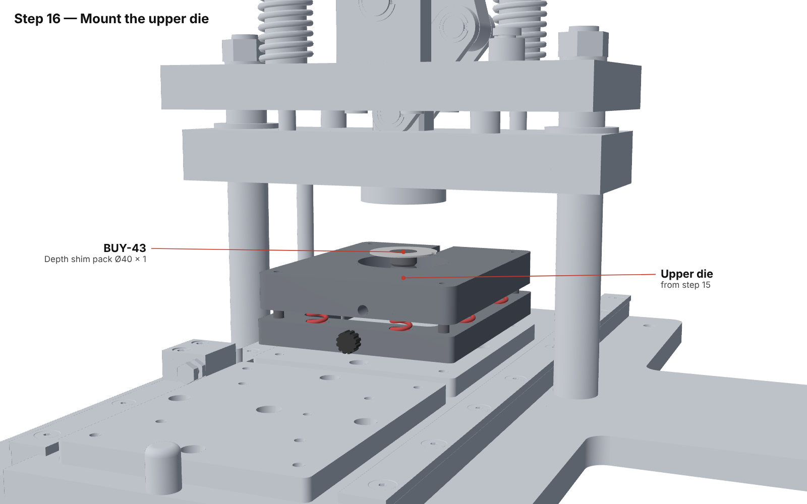

| Part | Name | Qty | 3D model |
|---|---|---|---|
| — | Upper die from step 15 |  |  |
| BUY-43 | Depth shim pack Ø40 × 1 | 1 | [STEP](../models/step/BUY-43_depth-shim-pack-d40-x-1.step) · [STL](../models/stl/BUY-43_depth-shim-pack-d40-x-1.stl) |

**Tools:** 2.5 mm hex key

1. Put the shim pack on the body top over the shank and orientation pin. Start with no shims; the depth is set in step 19.
2. Push the shank up into the die holder, the orientation pin into the holder's Ø4 hole (front).
3. Tighten the cone-point lock screw into the shank's V-groove with the hex key through slot W in the die body (from the right-hand end), firmly (about 3 N·m).

> ✅ **Check.** Upper die face parallel to the table within 0.05 at all four corners.

## Part E — Size kit

### Step 17 — Prepare a size kit

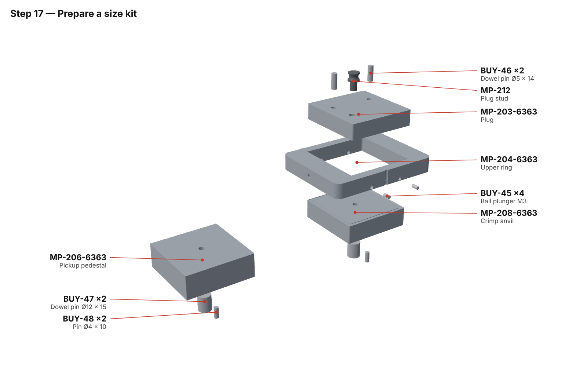

| Part | Name | Qty | 3D model |
|---|---|---|---|
| MP-203-6363 | Plug, kit 63.5 × 63.5 | 1 | [STEP](../models/step/MP-203-6363_plug-kit-63-5-x-63-5.step) · [STL](../models/stl/MP-203-6363_plug-kit-63-5-x-63-5.stl) |
| BUY-46 | Dowel pin Ø5 × 14 (plug) | 2 | [STEP](../models/step/BUY-46_dowel-pin-d5-x-14-plug.step) · [STL](../models/stl/BUY-46_dowel-pin-d5-x-14-plug.stl) |
| MP-212 | Plug stud (size kit, same for every size) | 1 | [STEP](../models/step/MP-212_plug-stud-size-kit-same-for-every-size.step) · [STL](../models/stl/MP-212_plug-stud-size-kit-same-for-every-size.stl) |
| MP-204-6363 | Upper ring, kit 63.5 × 63.5 | 1 | [STEP](../models/step/MP-204-6363_upper-ring-kit-63-5-x-63-5.step) · [STL](../models/stl/MP-204-6363_upper-ring-kit-63-5-x-63-5.stl) |
| BUY-45 | Ball plunger M3 (upper ring) | 4 | [STEP](../models/step/BUY-45_ball-plunger-m3-upper-ring.step) · [STL](../models/stl/BUY-45_ball-plunger-m3-upper-ring.stl) |
| MP-206-6363 | Pickup pedestal, kit 63.5 × 63.5 | 1 | [STEP](../models/step/MP-206-6363_pickup-pedestal-kit-63-5-x-63-5.step) · [STL](../models/stl/MP-206-6363_pickup-pedestal-kit-63-5-x-63-5.stl) |
| BUY-47 | Dowel pin Ø12 × 15 (pedestal and anvil spigot) | 2 | [STEP](../models/step/BUY-47_dowel-pin-d12-x-15-pedestal-and-anvil-spigot.step) · [STL](../models/stl/BUY-47_dowel-pin-d12-x-15-pedestal-and-anvil-spigot.stl) |
| BUY-48 | Pin Ø4 × 10 (pedestal and anvil anti-rotation) | 2 | [STEP](../models/step/BUY-48_pin-d4-x-10-pedestal-and-anvil-anti-rotation.step) · [STL](../models/stl/BUY-48_pin-d4-x-10-pedestal-and-anvil-anti-rotation.stl) |
| MP-208-6363 | Crimp anvil, kit 63.5 × 63.5 | 1 | [STEP](../models/step/MP-208-6363_crimp-anvil-kit-63-5-x-63-5.step) · [STL](../models/stl/MP-208-6363_crimp-anvil-kit-63-5-x-63-5.stl) |

**Tools:** Press, 3 mm hex key, depth gauge or feelers, torque wrench, Loctite 243 and 222

1. Do this once per kit; every kit is prepared the same way. Kit 6363 is shown.
2. Plug: press the two Ø5 × 14 dowels into the D holes on the top face, 5.5 mm proud. Screw the stud (MP-212) into the M6 hole, Loctite 243, 8 N·m. A round plug (MP-223) is prepared the same way.
3. Upper ring: screw the four M3 ball plungers into the side holes until each ball stands 0.2 to 0.3 mm into the opening. Lock with Loctite 222.
4. Pickup pedestal and crimp anvil: press a Ø12 × 15 dowel into the underside hole C (7 mm proud) and a Ø4 × 10 pin into hole Q (4 mm proud). Round kits (Rev D) have no hole Q and no Ø4 pin: a round pedestal or anvil can turn.
5. Rings A and B need no preparation. Check every part carries the kit's size code (and U, A or B).

> ✅ **Check.** Plug dowels and stud square to the face; plungers all the same protrusion.

### Step 18 — Fit the size kit

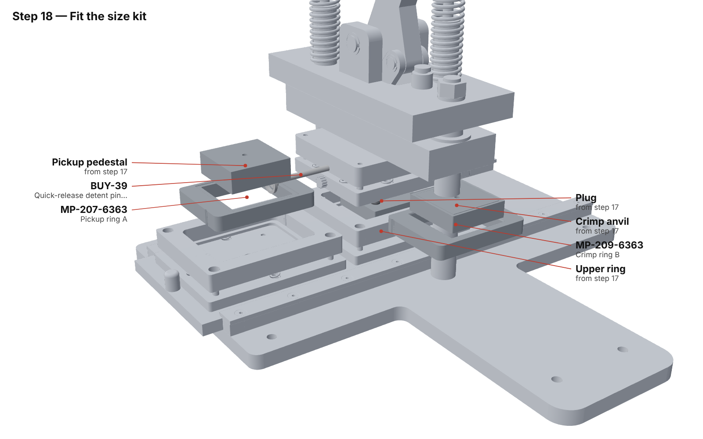

| Part | Name | Qty | 3D model |
|---|---|---|---|
| — | Plug from step 17 |  |  |
| — | Upper ring from step 17 |  |  |
| — | Pickup pedestal from step 17 |  |  |
| — | Crimp anvil from step 17 |  |  |
| BUY-39 | Quick-release detent pin Ø6, usable length 64, ring handle | 1 | [STEP](../models/step/BUY-39_quick-release-detent-pin-d6-usable-length-64-ring-handle.step) · [STL](../models/stl/BUY-39_quick-release-detent-pin-d6-usable-length-64-ring-handle.stl) |
| MP-207-6363 | Pickup ring A, kit 63.5 × 63.5 | 1 | [STEP](../models/step/MP-207-6363_pickup-ring-a-kit-63-5-x-63-5.step) · [STL](../models/stl/MP-207-6363_pickup-ring-a-kit-63-5-x-63-5.stl) |
| MP-209-6363 | Crimp ring B, kit 63.5 × 63.5 | 1 | [STEP](../models/step/MP-209-6363_crimp-ring-b-kit-63-5-x-63-5.step) · [STL](../models/stl/MP-209-6363_crimp-ring-b-kit-63-5-x-63-5.stl) |

**Tools:** None

1. With the handle up on its stop, offer the plug up to the die body: dowels into the D holes, stud into hole K. It only fits one way. A round plug (Rev D) goes on the inner holes instead: dowels into D2, stud into K2.
2. Push the detent pin in from the left end of the die body until it clicks. It passes through the stud and holds the plug.
3. Push the upper ring up into the upper carrier with its key slots on the key pins, and tighten the two thumb screws.
4. Drop pickup ring A into carrier A, then the pickup pedestal through it, dowel into hole C and pin into hole Q (round kits: dowel only).
5. Drop crimp ring B into carrier B, then the crimp anvil the same way. The key pins stop a ring going into the wrong carrier.

> ✅ **Check.** One slow dry stroke on each station: the upper ring enters both lower rings without touching.

## Part F — Set-up and tests

### Step 19 — Feet, set-up and first magnets

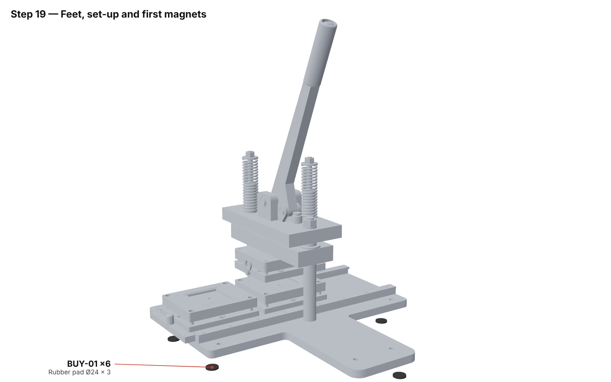

| Part | Name | Qty | 3D model |
|---|---|---|---|
| BUY-01 | Rubber pad Ø24 × 3 | 6 | [STEP](../models/step/BUY-01_rubber-pad-d24-x-3.step) · [STL](../models/stl/BUY-01_rubber-pad-d24-x-3.stl) |

**Tools:** Calipers, 10 kN load cell and dummy block, hanging scale, marker

1. Stick the six pads under the base, clear of the six bench holes: four at (±200, ±80) and two under the tongue.
2. Put the press on a flat bench (two people: it weighs about 48 kg). For all-day use bolt it down through the Ø9 holes.
3. Set the depth: make a magnet, then add shims (0.1 / 0.2 / 0.5) until the crimp finishes with the handle about 5 to 10° above horizontal. Write the shim value on the frame label.
4. Run the tests in the table below, then make two test magnets per kit and check the corners and the crimp.
5. Consumables for a square kit: flat tin blanks X + 8 cut from 0.20 mm soft tinplate, photo and film X + 9, all with the corners clipped on the 45° line printed by the Magnet Studio (`web/magnet-studio.html`); 1.2 mm back plates X − 1.4; magnet sheet X − 8. Round kits use drawn round cups.

> ✅ **Check.** Every test in the table below passes.

| Test | How | Pass |
|---|---|---|
| Station alignment | Step 14. | ±0.05 mm at both stations |
| Station pilot | Table 3 mm off station, slow stroke; repeat at the other station and on the other side. | Stroke stops with the dies at least 5 mm apart |
| Handle return | Pull the handle fully down onto its stop and let go, 20 times. | Returns to the open stop every time |
| Stroke and handle stop | Measure ram travel from handle up to handle down. | 38.9 ±0.3 mm; handle stops 3° above horizontal |
| Depth | Shims so the crimp finishes with the handle 5 to 10° above horizontal (step 19). | Full crimp with a firm push, no hard knock |
| Force | 10 kN load cell on station B with a dummy block; 200 N on the grip with a hanging scale. | ≥ 5.5 kN |
| Ring alignment | Marker blue on the lower ring tops, slow stroke on each station. | Even contact all round; the upper ring never touches a lower ring edge |
| Stroke 1 fold | Slow stroke 1 at station A with a flat tin blank only; lift the ram and look at the shell in the upper ring. | Four straight walls about 4 mm deep, square corners with a small flat gusset, nothing left in the recess |
| Magnet quality | Make 20 of each size. | No white paper at the edges, no torn film, sharp corners with neat mitres on the back, back border flat all round |
| Size-kit change | Change the kit, timing it; try each wrong ring in each carrier. | Under 2 minutes; no wrong ring seats |
| Reference height | Handle on its closed stop: die-holder face to table top. Write it on the frame label. | Re-check after any service; within 0.1 mm |
| Proof load (prototype only) | 20 kN cell on station B, push the grip to 16 kN; dial indicator before and after. | No permanent set; stroke still 38.9 ±0.3 |
| Endurance (prototype) | 1,000 strokes, then 10,000; repeat alignment and quality checks. | No change; no galling; ≤ 1 mm handle play at the grip |

## Changing the size kit

1. Rest the handle up on its stop and push the table to the right (station A under the ram).
2. Upper: hold the upper ring, loosen its two thumb screws and lower it out. Pull the detent pin out to the left by its ring, and lower the plug off its dowels.
3. Fit the new plug (it only fits one way: square plugs on the outer holes D and K, round plugs on the inner holes D2 and K2) and push the pin home. Push the new upper ring up so its key slots meet the pins, and tighten the thumb screws.
4. Lower: screw the M5 T-handle puller into each pedestal or anvil and lift it out, then lift the ring out by its opening. Drop in the new ring A and pickup pedestal on the left, and ring B and crimp anvil on the right.
5. One slow dry stroke on each station, then two test magnets. Check the corners (or, on a round magnet, the whole edge) and the crimp before running a batch.

## Maintenance

| When | Task |
|---|---|
| Each shift | Wipe the die table, rails and dies. Blow shell chips out of the rings. No oil on the dies. |
| Weekly or 5,000 strokes | Check the thumb screws, the die lock screw and the handle-stop setting. Light oil on the rails only. |
| 25,000 strokes | Check handle play (≤ 1 mm at the grip) and the column nut torque. Clean tin pick-up from the die edges with a brass brush. |
| 100,000 strokes | Replace the eight red upper die springs (they work to 29% of their length). |
| 250,000 strokes | Replace the lower die springs and the return springs. Inspect the bushings and pins. Dye-penetrant check the die corners. |

If a shell jams, follow the un-jam procedure in [`docs/research/failure-review.md`](research/failure-review.md#un-jam-procedure).
