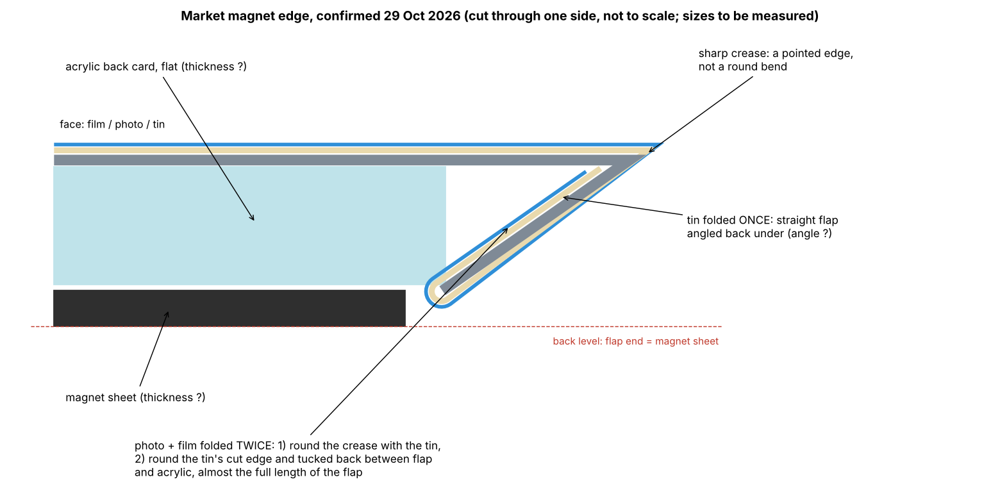

# How a market square photo magnet is built

From a bought magnet taken apart (video frames in this folder, 29 Oct 2026), a seller's product photo
(`ad1dac50-image.jpg`) and supply listings. Confirmed with the owner; sizes still to be measured.

| Part | What it is |
|---|---|
| Front sheet | Tinplate ("iron sheet"), flat blank. Folded **once**: a sharp crease at the face edge (a pointed edge, not a round bend), then a straight flap angled back under the magnet. The side of the magnet is a slope, not a vertical wall |
| Back card | Flat acrylic card inside the fold, behind the face. The flap bears on its back edge and holds it in |
| Photo and film | Cut bigger than the tin (the film as an octagon, corners clipped). Folded **twice**: round the crease with the tin, then round the tin's cut edge and tucked back between the flap and the acrylic, for almost the full length of the flap. The tin's cut edge never shows |
| Magnet sheet | On the back of the acrylic. The flap ends level with it, so the back is level |

Blank sizes that follow from this: per side, the tin extends one flap length past the face; the photo and film about
two flap lengths. A commercial 65 × 90 set (grawerton.pl, set 1116) fits: sheet 73 × 98 (4 mm a side), film 84 wide
(9.5 mm a side), card 62 × 83, magnet 57 × 82.

Pressing, as the listings describe it: side A presses the sheet, photo and film together; side B presses them onto the
acrylic card (with the magnet).

## Figures from the owner (29 Oct 2026, general, not measured on the dissected piece)

- Round 2.5-inch (63.5 mm) magnet: photo and film cut Ø74.2 mm (2.92 in), tinplate shell Ø63 mm (2.48 in): about
  5.4 mm of photo and film per side beyond the finished face. Round magnets use a pre-formed shell, so this does not
  carry over to the square fold (the square 65 x 90 set has 9.5 mm of film per side).
- Typical thicknesses: acrylic card 2.0 mm (snap-in kits) or 3.0 mm (premium, UV face printing); magnet sheet 1.0 mm
  anisotropic rubber with self-adhesive backing; finished magnet 3.0-4.1 mm. (3 mm acrylic + 1 mm magnet + tin, photo
  and film is about 4.4 mm, above the 4.1 quoted: the real set must differ somewhere.)
- The three white dots on the dark square in the product photo are holes for safety pins in that acrylic design: not
  relevant.

Flap angle from these (65 x 90, flap about 4 mm): about 45 deg from the face with 2 mm acrylic (total about 3.4 mm, side
slopes in about 2.9 mm, flat back about 59 x 84), about 60 deg with 3 mm acrylic (about 4 mm thick, slopes in about 2 mm,
flat back about 61 x 86).

## Material set photo (29 Oct 2026)

`set-tin-and-film.jpg`: the tin in a bought set appears to come already formed, as a shallow tray with sloping sides
(as in the product photo), with octagonal films (corners clipped at 45 deg). To confirm with the owner: whether the tin
is supplied pre-formed. If so, the press only wraps the photo and film over a ready shell and then folds its sloping
sides further in over the acrylic card. No scale in this photo, so no sizes taken from it.

## Still to measure

- Flap angle: width of the sloped side seen from the edge, or the flat back size against the face size.
- Thickness of the acrylic card, the magnet sheet and the whole magnet.
- Whether the tin comes pre-formed; its wall depth and slope (side photo on the grid mat).
- Face size of the dissected piece (50 x 50, 63.5 x 63.5, 53 x 80 or 65 x 90).
- For the first size, one pre-cut set from the chosen seller: tin size and thickness, film size and corners, acrylic
  card size and thickness, magnet sheet size and thickness.
