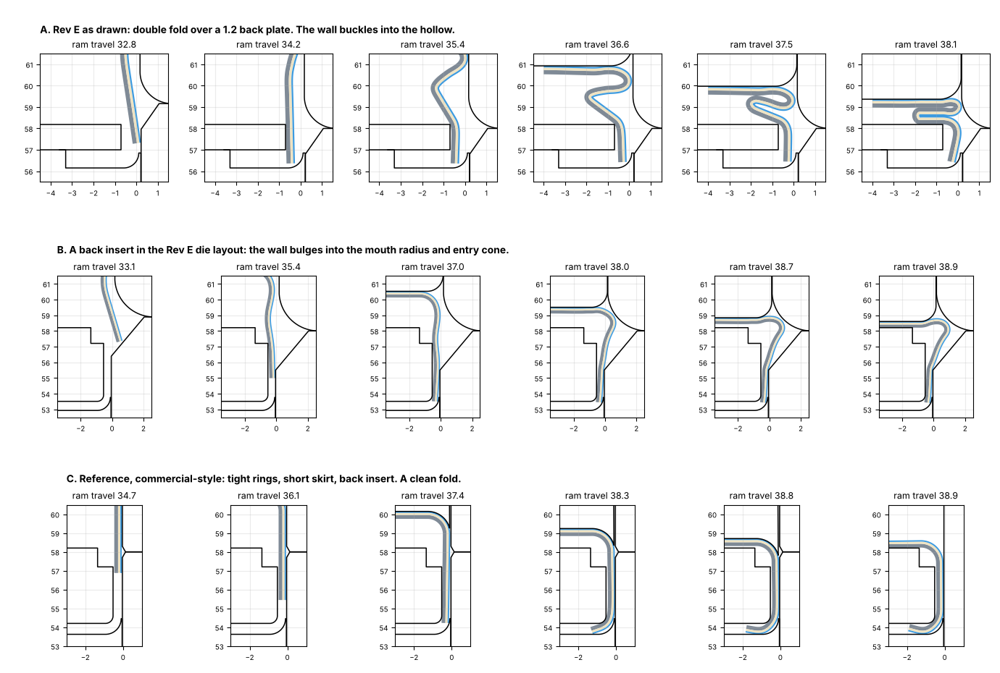
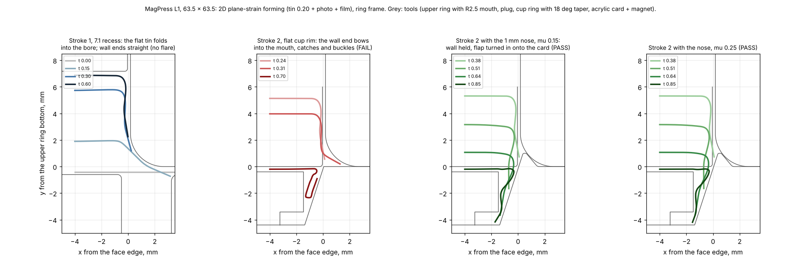

# MagPress M4 Rev E: verification before building

What was checked, with which open-source tools, and what came out. The scripts are in [`verify/`](../verify/README.md).

**Can anyone guarantee zero changes after building? No.** The frame, drive and fits can be proven on paper, and they
are below: they pass. Forming 0.20 mm tin with paper and film always needs some setting on the first parts. This
verification set out to find anything that would mean re-machining hardened steel, and it found one: **the square size
kits do not form as drawn**. Stroke 1 needed a fix, which is found and checked. Stroke 2, the double flat fold on the
back, fails in simulation, and no change within the Rev E die layout fixes it. A commercial-style crimp passes in the
same model, which shows what the square kits must change to (section 4). Do not make the square kits until that rework
has been done and verified (section 5).

## Summary

| Check | Tool | Result |
|---|---|---|
| Every part against every other part through the whole stroke, 1° steps | CadQuery / OpenCASCADE | **Pass** — no overlap at any of 63 handle positions, nor with a round kit fitted |
| Every screw, stud, nut, plunger and pin: thread length in metal, head seating | CadQuery / OpenCASCADE | **Pass** — 91 checked; screws engage ≥ 1.3 d in steel. One small fix: orientation pin |
| Crown at 16 kN | CalculiX (C3D10) | **Pass** — 136 MPa peak, safety factor ≈ 2.5 on yield |
| Base plate at 16 kN | CalculiX | **Pass** — 155 MPa peak, SF ≈ 2.3; the station area sinks 0.17 mm |
| Handle lever, 500 N lean at the stop | CalculiX | **Pass** — 127 MPa in the lug, SF ≈ 2.7 |
| Lateral alignment, upper die to lower dies | Tolerance stack | **Pass** — worst case ±0.14 mm against 0.28 mm of room |
| Forming solver | Validation | Elastic bending within 0.4 % of beam theory, plastic collapse within 0.5 % |
| Stroke 1: flat blank folded into the upper ring | Explicit forming model (own solver, validated) | **Fails as drawn**: the flange is drawn at 15–17 N/mm, more than the springs hold. **Fix found:** ring A opening X + 10.5, upper-ring mouth R2.5 (5.8 N/mm; 65 × 90 plug ≥ 1.05 mm clear) |
| Stroke 2: the double flat fold (square kits) | Explicit forming model | **Fails**: the wall buckles. Every variant in the Rev E layout fails; a commercial-style crimp passes in the same model. **Square kits on hold** (section 5) |
| Corners | Geometry | Clip line leaves the edge covered to the corner and a 1.5 mm² gusset; mitre on the back as intended |
| Manufacturability, Indian materials | Review | Orientation pin fixed in the sources; anvil-rim land noted for the reworked anvil; material equivalents and process notes |

## 1. Fit: interference through the stroke

`verify/sweep.py` places all 190 parts and moves the ram group, lever and links to every whole degree of handle angle
from 64.9° (up) to 3° (on the stop): 63 positions. Each moving part is intersected with every other part (OpenCASCADE
booleans, overlaps above 1 mm³). Die parts against die parts are skipped because the spring-loaded rings telescope by
design. **No overlaps at any position** ([sweep.txt](../verify/sweep.txt)). The model build also checks the round kit
D58 fitted instead of kit 6363: no overlaps.

## 2. Fit: screws, studs and pins

The 3D models show threaded holes at the thread's nominal size (an M5 hole is a plain Ø5 hole), so overlap checks alone
cannot say whether a screw holds. `verify/fitcheck.py` puts a thin probe ring just outside each screw's thread (inside,
for nuts) over its threaded length and measures how much of it lies in metal in each part:

- Every screw is threaded into one part only, with **at least 1.3 × its diameter** of engagement in steel (M5 8–14 mm,
  M8 11 mm, M10 13 mm; the M16 column nuts are fully on their threads), and every head or countersink seats on the part
  it clamps. The only screws in two threaded parts are the adjustable stop screws with their lock nuts, as intended.
- Key pins enter the kit rings 1.5 mm and the pedestal/anvil spigot dowels enter the station bases 7 mm: both are
  locators only, by design.
- **Fix:** the die-holder orientation pin (Ø4 × 10) enters the die holder only 3.0 mm, less with shims. Changed to
  Ø4 × 12 with the holder hole 8 deep: 5–6 mm.

Full list: [fitcheck.txt](../verify/fitcheck.txt).

## 3. Strength of the frame (CalculiX)

Linear-elastic models meshed with gmsh (10-node tetrahedra), solved in CalculiX, at the 16 kN design load (a 500 N lean
on the grip):

| Part | Load and supports | Peak von Mises | Safety factor on yield | Hand calculation |
|---|---|---|---|---|
| Crown MP-108, C45 | 16 kN up through the four cheek bolts; held by the column nuts | 136 MPa at the inner edge of the cheek-bolt counterbores | ≈ 2.5 | 121 MPa |
| Base plate MP-101, S355 | 16 kN down under station B; 2 × 8 kN up at the column clamps | 155 MPa at the top edge of the column holes | ≈ 2.3 | — |
| Handle lever MP-113, C45 | 500 N at the grip; 15.6 kN link force at pin A; pin O held | 127 MPa in the lug beyond pin A | ≈ 2.7 | 36 MPa in the bar |

At the normal 200 N push the stresses are 40 % of these. Deflections: crown 0.045 mm; base plate 0.17 mm under the
station (the hand calculation said 0.26 mm); lever 0.5 mm at the grip.

## 4. Forming

No ready-made open-source tool simulates a thin layered strip folded between moving rigid dies (CalculiX contact
diverged on this problem; OpenRadioss could not be installed here), so `verify/xform.py` is a purpose-written explicit
solver: the tin, photo and film as one strip of 15 fibres through the thickness (each with its own elastic-plastic law),
large rotations, penalty contact against the moving die outlines, self-contact and friction. It matches beam theory to
0.4 % and the plastic collapse load to 0.5 % (`verify/val1.py`).

What it can and cannot say:

- It is a 2D cut across one side of the magnet (plane strain). That is right for the straight sides of a square
  magnet, which are 50–90 mm long, but it says nothing about the corners, and nothing about round magnets, whose edge is
  stiffened by its own ring shape.
- The three layers are bonded together, while the real photo and film can slip on the tin, so the model is a little
  stiffer than the real stack.
- Friction 0.15 stands for a clean, lightly lubricated die and 0.25 for the film on dry steel. Every result was run at
  both.

### Stroke 1: the flat blank folded into the upper ring

| Tooling | Force on the upper ring | 65 × 90 kit (worst case, friction 0.25) |
|---|---|---|
| **As drawn:** 0.3 × 30° lead-in, blank lying on ring A's recess floor | 14.5–16.8 N per mm of edge, rising to the end: the flange is **drawn** over the ring, not folded | ≈ 4.5–5 kN against 1.57 kN of spring preload: the upper ring gives way and the plug lands on the face half way through the fold. **Fails** |
| Ring A opening X + 10.5 (the blank rests on a 0.5 ledge after an R0.5 edge), mouth R1.5 | peak 6.5–7.0 N/mm early in the fold, 1.1–1.6 at the end | plug −0.55 mm from the face: **fails** |
| Same, mouth R2.0 | peak 6.1–6.2 N/mm | plug 0.34 mm clear: too little |
| **Same, mouth R2.5** | **peak 5.8 N/mm, 1.2 at the end** | **plug ≥ 1.05 mm clear** (6363: 2.7, 5380: 2.3, 5050: the ring does not give) |

With the wider ring A opening, the flange slides off the ledge once the fold starts and is wiped down instead of being
pulled through. At the end of the fold every kit's force is below the spring preload, so the upper ring is back on its
seat when the plug sets the face. After release the walls stand 0.2–0.3 mm inside the upper ring's bore, so friction
does not hold the shell; the four M3 ball plungers must be set 0.4–0.5 mm proud (they are moved to 3.0 mm above the
ring's bottom face, clear of the R2.5 mouth). A shorter flange (blank X + 10) does not reduce the peak, which comes from
the bend at the mouth.

### Stroke 2: the edge folded under the back (square kits)

**A. As drawn, the double flat fold does not form.** When the end of the 5.6 mm wall meets the anvil's cove, the cove
pushes it inward. On a round shell the ring of metal resists that. On a straight side nothing does: the back plate's
edge is 0.5 mm inside the wall. So the whole lower wall moves inward, the end lands flat on the floor and the curl never
starts. The plug then compresses a wall that is free for 4.5 mm above the 1.2 mm back plate, and it buckles into an S.
The result is the same with and without the 0.1 mm rim land, at friction 0.15 and 0.25, and from either stroke-1 shape.
Ring B's lead-in also had to stay above the rim: a 2.0 mm lead-in lets the end slip outward past the rim.

**B. A back insert that fills the shell is necessary, but in the Rev E die layout it is not enough.** With a 3.5–4.7 mm
insert just inside the wall, the cove does curl the edge under the insert. But stroke 1 leaves the walls flared out
below the upper ring, so ring B needs a wide entry cone to catch them. Stroke 1 also needs the large R1.5–R2.5 mouth on
the upper ring. Together they leave a pocket with no outside support exactly where the wall has to carry the folding
force, and the wall bulges into it. Tried and failed:
- insert 3.5, 4.0 and 4.7–5.3 mm thick;
- cove R0.7–1.05;
- tight and wider channels;
- anvil land 0.05 and 0.10;
- friction 0.15 and 0.25.

**C. Reference: a commercial-style crimp forms cleanly in the same model.** The shell is pre-formed with a 4.7 mm skirt.
Both the upper ring and ring B are 0.03 mm off the wall, with only 0.3 mm lead-ins, and a 3.5–4.0 mm insert fills the
shell. The edge turns in the cove and runs 1.4–2.2 mm inward under the insert, and the face seats on the insert, with no
buckling. This held at friction 0.15 and 0.25 and with a 0.1 mm land, at a plug force of 34–41 N/mm (about 10–12 kN for
65 × 90, inside the press's rating). This is the check that the model is not simply pessimistic: it forms the kind of
crimp that commercial machines use, and fails the Rev E one.

**What a working square crimp needs:**
- the wall held from the outside right up to the face, so no large mouth radius or entry cone at the joint between the
  upper ring and ring B;
- a short skirt;
- a back that fills the shell.

Commercial 65 × 90 kits match this. They use a flat sheet 73 × 98 (4 mm over the face, not 6), pressed with the photo
and film on one side of the machine, then pressed over a thick card back with a magnet sheet on the other. In the Rev E
layout the upper ring needs its large mouth for stroke 1, which is what opens the pocket. A shorter flange (X + 8 or
X + 10) does not lower the stroke-1 peak, and with X + 8 the 65 × 90 kit's upper ring gives too far (plug −0.7 to
−1.2 mm). Getting there therefore means reworking the square kits and probably the universal die's upper springs. That
needs a decision first (section 5).

**Round kits** use the standard button-machine process (a drawn round cup rolled over the back). The 2D model cannot
simulate them, because a round edge is held by its own ring stiffness, which is exactly what the straight sides lack.
They carry the ordinary risk of any new button die: the roll channel may need polishing or a small adjustment on the
first parts.

## 5. What this means for building

| Part of the press | Status | Advice |
|---|---|---|
| Frame, drive, handle, table (MP-101 to MP-121) | Verified: fit, strength, fasteners, motion | Unaffected by the forming findings, but wait for the decision below before ordering, in case the die heights change |
| Universal die (die body, carriers, springs) | Fit and strength verified | Hold: a working square crimp probably needs stronger upper springs |
| Round size kits (Rev D) | Standard button process, not simulated | Lowest risk of the kits |
| Square size kits (Rev E) | **Stroke 1 fails as drawn (fix found); stroke 2 fails, and no fix yet within this layout** | **Do not make** |

The options for square magnets:
1. **Rework the square kits to the commercial recipe.** Short flange, thick card-and-magnet back, single fold, tight
   rings, stronger upper springs. Then re-run this verification before any steel is cut. This is design work only: no
   cost to you until the build.
2. **Build round kits first,** and decide on square later.
3. **Buy a ready-made square press** for the square sizes (₹10,000–46,000, see the sourcing guide), and use the MagPress
   for round magnets.

Whichever is chosen, a ₹300–500 pack of commercial square-magnet consumables (sheet, film, card back, magnet), measured
with calipers, settles the exact sizes before anything is machined.

The forming scripts: `verify/stroke1x.py` (stroke 1), `stroke2x.py` (Rev E double fold), `stroke2y.py` (back insert),
`stroke2c.py` (reference crimp), `s1check.py` (upper-carrier give and plug clearance per kit), `fplot1.py`,
`fplot2.py` (figures). The run log is [`verify/findings-log.md`](../verify/findings-log.md).

## 6. Manufacturability and materials in India

- **Fix: the crimp anvil's rim.** The cove R0.7 is tangent to the anvil side at the rim, which leaves a knife edge of
  zero thickness. In hardened tool steel it would chip on the first parts. A 0.10 mm flat land at the rim (cove moved
  in 0.10) removes it; the forming model was run with and without the land.
- The cove and the pedestal's R0.8 edge run round the whole outline: they are not 2D wire-EDM profiles. Rough them soft,
  harden, then finish by hard milling (Ø1.4 ball nose, coated carbide) or die-sink EDM, and polish.
- A2 (1.2363) is rarely stocked in India; order D2 (1.2379, "HCHCr") for the kit parts, vacuum hardened to 58–60 HRC
  and tempered twice. Other equivalents: C45 ≈ EN8/EN9, 42CrMo4 ≈ EN19, 100Cr6 ≈ EN31, S355 ≈ IS 2062 E350.
- The 210.00 hole pitch in the base, crown and ram must match: machine each in one set-up from the same program and
  check it on a CMM.
- Hard anodising grows the die table about 0.025 mm per face: mask the pilot and dowel holes or ream them afterwards.
- Columns can be induction-hardened chrome bar ground to Ø25 h6 (hydraulic rod is usually f7).

Where to buy everything and what it costs: [sourcing-india.md](sourcing-india.md).

## 7. Light design MagPress L1 (29 Oct 2026)

The light press (`light/`, drawings L1-A) was checked with the same tools.

| Check | Result |
|---|---|
| Interference, 3D, every part | **Pass.** No overlap at 6 handle positions at each station or while the table slides (131 placed parts; springs excluded). |
| Strength at the 15 kN abuse load (hand calculation, `light/results.txt`) | **Pass.** Head 95 MPa; stub pins O 145 MPa and pins A/B 154 MPa bending (EN8); cheek screws 102 MPa; columns 89 MPa in the thread; base about 82 MPa. An earlier single-plate lever with a 12 mm pin O was 1100 MPa in the pin, so the lever became a fork of two plates on 16 mm stub pins. |
| Stroke 1, flat 71.5 tin, R2.5 mouth, 7.1 recess | **Pass.** 7.8–8.3 N/mm (about 2.1 kN), held by 2.87 kN of spring preload. The wall ends straight in the bore. With a 4.6 recess the wall ended in the mouth and flared 0.9 mm. |
| Stroke 2, market edge (flap turned in 18° onto the acrylic card) | **Pass, with the 7.1 recess and a 1 mm nose on the cup ring that fills the mouth.** Checked at µ 0.15 and 0.25. Every variant without the nose, and the 4.6 recess with the nose, fails: the wall buckles or the flare is pinched. |
| Not modelled | The photo and film tuck round the tin's cut edge; the plan-view corners; the real acrylic stiffness. The flap reaches the cup floor about 0.2 mm early in the model, so tune the blank or the cup depth with real material. |

Before ordering the hardened die set:
- measure the seller's pre-cut set;
- adjust the MAT parts;
- make the first die set in P20;
- press real magnets.
