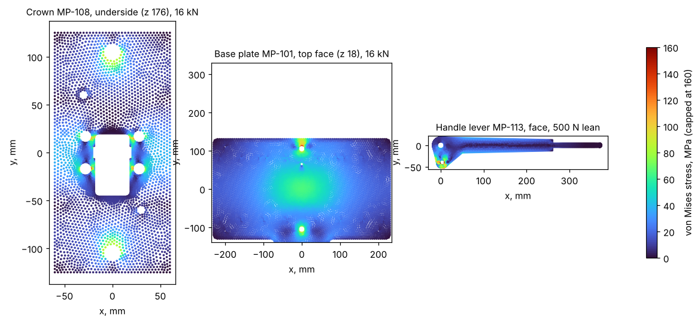
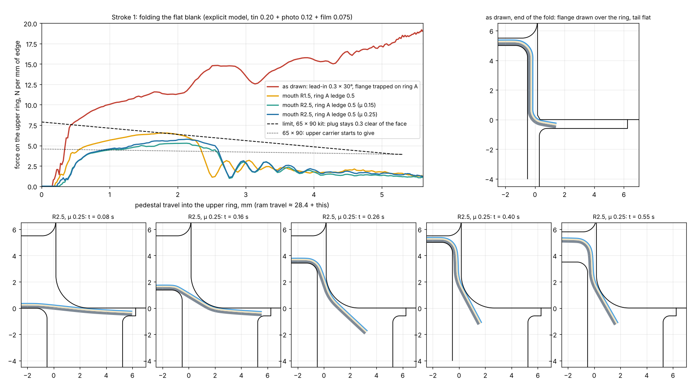

# MagPress M4 Rev E: verification before building

What was checked, with which open-source tools, and what came out. The scripts are in [`verify/`](../verify/README.md).

**Can anyone guarantee zero changes after building? No.** The frame, drive and fits can be proven on paper, and they
are below. The forming of 0.20 mm tin with paper and film is a different matter: springback, friction, paper thickness
and the corners always need a little setting on the first parts, in every press tool made. What the checks below do is
find the problems that would otherwise need re-machining, and make sure what is left can be set with adjustments and
consumables (shim pack, handle stop, blank size) rather than new steel.

## Summary

| Check | Tool | Result |
|---|---|---|
| Every part against every other part through the whole stroke, 1° steps | CadQuery / OpenCASCADE | **Pass** — no overlap at any of 63 handle positions, nor with a round kit fitted |
| Every screw, stud, nut, plunger and pin: thread length in metal, head seating | CadQuery / OpenCASCADE | **Pass** — 91 checked; screws engage ≥ 1.3 d in steel. One small fix: orientation pin |
| Crown at 16 kN | CalculiX (C3D10) | **Pass** — 136 MPa peak, safety factor ≈ 2.5 on yield |
| Base plate at 16 kN | CalculiX | **Pass** — 155 MPa peak, SF ≈ 2.3; the station area sinks 0.17 mm |
| Handle lever, 500 N lean at the stop | CalculiX | **Pass** — 127 MPa in the lug, SF ≈ 2.7 |
| Lateral alignment, upper die to lower dies | Tolerance stack | **Pass** — worst case ±0.14 mm against 0.28 mm of room |
| Forming solver | Validation | Elastic bending within 0.4 % of beam theory, plastic collapse within 0.5 % |
| Stroke 1: flat blank folded into the upper ring | Explicit forming model | _see section 4_ |
| Stroke 2: the double flat fold | Explicit forming model | _see section 4_ |
| Corners | Geometry | Clip line leaves the edge covered to the corner and a 1.5 mm² gusset; mitre on the back as intended |
| Manufacturability, Indian materials | Review | Two fixes (anvil rim, orientation pin), process notes |

## 1. Fit: interference through the stroke

`verify/sweep.py` places all 190 parts and moves the ram group, lever and links to every whole degree of handle angle
from 64.9° (up) to 3° (on the stop): 63 positions. Each moving part is intersected with every other part (OpenCASCADE
booleans, overlaps above 1 mm³). Die parts against die parts are skipped because the spring-loaded rings telescope by
design. **No overlaps at any position** ([sweep.txt](../verify/sweep.txt)). The model build also checks the round kit
D58 fitted instead of kit 6363: no overlaps.

## 2. Fit: screws, studs and pins

The 3D models show threaded holes at the thread's nominal size (an M5 hole is a plain Ø5 hole), so overlap checks alone
cannot say whether a screw holds. `verify/fitcheck.py` puts a thin probe ring just outside each screw's thread (inside,
for nuts) over its threaded length and measures how much of it lies in metal in each part:

- Every screw is threaded into one part only, with **at least 1.3 × its diameter** of engagement in steel (M5 8–14 mm,
  M8 11 mm, M10 13 mm; the M16 column nuts are fully on their threads), and every head or countersink seats on the part
  it clamps. The only screws in two threaded parts are the adjustable stop screws with their lock nuts, as intended.
- Key pins enter the kit rings 1.5 mm and the pedestal/anvil spigot dowels enter the station bases 7 mm: both are
  locators only, by design.
- **Fix:** the die-holder orientation pin (Ø4 × 10) enters the die holder only 3.0 mm, less with shims. Changed to
  Ø4 × 12 with the holder hole 8 deep: 5–6 mm.

Full list: [fitcheck.txt](../verify/fitcheck.txt).

## 3. Strength of the frame (CalculiX)

Linear-elastic models meshed with gmsh (10-node tetrahedra), solved in CalculiX, at the 16 kN design load (a 500 N lean
on the grip):

| Part | Load and supports | Peak von Mises | Safety factor on yield | Hand calculation |
|---|---|---|---|---|
| Crown MP-108, C45 | 16 kN up through the four cheek bolts; held by the column nuts | 136 MPa at the inner edge of the cheek-bolt counterbores | ≈ 2.5 | 121 MPa |
| Base plate MP-101, S355 | 16 kN down under station B; 2 × 8 kN up at the column clamps | 155 MPa at the top edge of the column holes | ≈ 2.3 | — |
| Handle lever MP-113, C45 | 500 N at the grip; 15.6 kN link force at pin A; pin O held | 127 MPa in the lug beyond pin A | ≈ 2.7 | 36 MPa in the bar |

At the normal 200 N push the stresses are 40 % of these. Deflections: crown 0.045 mm; base plate 0.17 mm under the
station (the hand calculation said 0.26 mm); lever 0.5 mm at the grip.

## 4. Forming

No ready-made open-source tool simulates a thin layered strip folded between moving rigid dies (CalculiX contact
diverged on this problem; OpenRadioss could not be installed here), so `verify/xform.py` is a purpose-written explicit
solver: the tin, photo and film as one strip of 15 fibres through the thickness (each with its own elastic-plastic law),
large rotations, penalty contact against the moving die outlines, self-contact and friction. It matches beam theory to
0.4 % and the plastic collapse load to 0.5 % (`verify/val1.py`).

What it can and cannot say:

- It is a 2D cut across one side of the magnet (plane strain). That is right for the straight sides of a square
  magnet, which are 50–90 mm long, but it says nothing about the corners, and nothing about round magnets, whose edge is
  stiffened by its own ring shape.
- The three layers are bonded together, while the real photo and film can slip on the tin, so the model is a little
  stiffer than the real stack.
- Friction 0.15 stands for a clean, lightly lubricated die and 0.25 for the film on dry steel. Every result was run at
  both.

### Stroke 1: the flat blank folded into the upper ring

| Tooling | Force on the upper ring | 65 × 90 kit (worst case, friction 0.25) |
|---|---|---|
| **As drawn:** 0.3 × 30° lead-in, blank lying on ring A's recess floor | 14.5–16.8 N per mm of edge, rising to the end: the flange is **drawn** over the ring, not folded | ≈ 4.5–5 kN against 1.57 kN of spring preload: the upper ring gives way and the plug lands on the face half way through the fold. **Fails** |
| Ring A opening X + 10.5 (the blank rests on a 0.5 ledge after an R0.5 edge), mouth R1.5 | peak 6.5–7.0 N/mm early in the fold, 1.1–1.6 at the end | plug −0.55 mm from the face: **fails** |
| Same, mouth R2.0 | peak 6.1–6.2 N/mm | plug 0.34 mm clear: too little |
| **Same, mouth R2.5** | **peak 5.8 N/mm, 1.2 at the end** | **plug ≥ 1.05 mm clear** (6363: 2.7, 5380: 2.3, 5050: the ring does not give) |

With the wider ring A opening, the flange slides off the ledge once the fold starts and is wiped down instead of being
pulled through. At the end of the fold every kit's force is below the spring preload, so the upper ring is back on its
seat when the plug sets the face. After release the walls stand 0.2–0.3 mm inside the upper ring's bore, so friction
does not hold the shell; the four M3 ball plungers must be set 0.4–0.5 mm proud (they are moved to 3.0 mm above the
ring's bottom face, clear of the R2.5 mouth). A shorter flange (blank X + 10) does not reduce the peak, which comes from
the bend at the mouth.

### Stroke 2: the edge folded under the back

_(being written)_

## 5. Manufacturability and materials in India

- **Fix: the crimp anvil's rim.** The cove R0.7 is tangent to the anvil side at the rim, which leaves a knife edge of
  zero thickness. In hardened tool steel it would chip on the first parts. A 0.10 mm flat land at the rim (cove moved
  in 0.10) removes it; the forming model was run with and without the land.
- The cove and the pedestal's R0.8 edge run round the whole outline: they are not 2D wire-EDM profiles. Rough them soft,
  harden, then finish by hard milling (Ø1.4 ball nose, coated carbide) or die-sink EDM, and polish.
- A2 (1.2363) is rarely stocked in India; order D2 (1.2379, "HCHCr") for the kit parts, vacuum hardened to 58–60 HRC
  and tempered twice. Other equivalents: C45 ≈ EN8/EN9, 42CrMo4 ≈ EN19, 100Cr6 ≈ EN31, S355 ≈ IS 2062 E350.
- The 210.00 hole pitch in the base, crown and ram must match: machine each in one set-up from the same program and
  check it on a CMM.
- Hard anodising grows the die table about 0.025 mm per face: mask the pilot and dowel holes or ream them afterwards.
- Columns can be induction-hardened chrome bar ground to Ø25 h6 (hydraulic rod is usually f7).

Where to buy everything and what it costs: [sourcing-india.md](sourcing-india.md).
