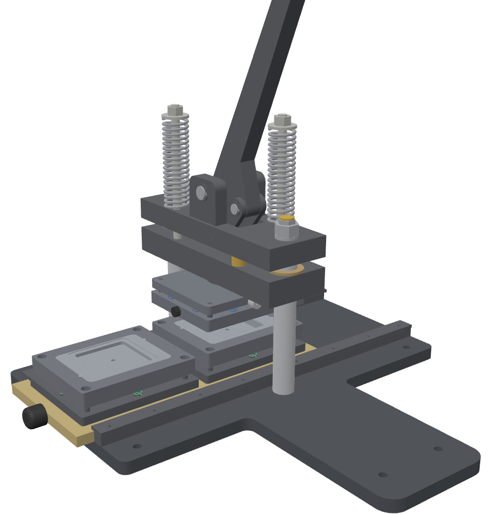
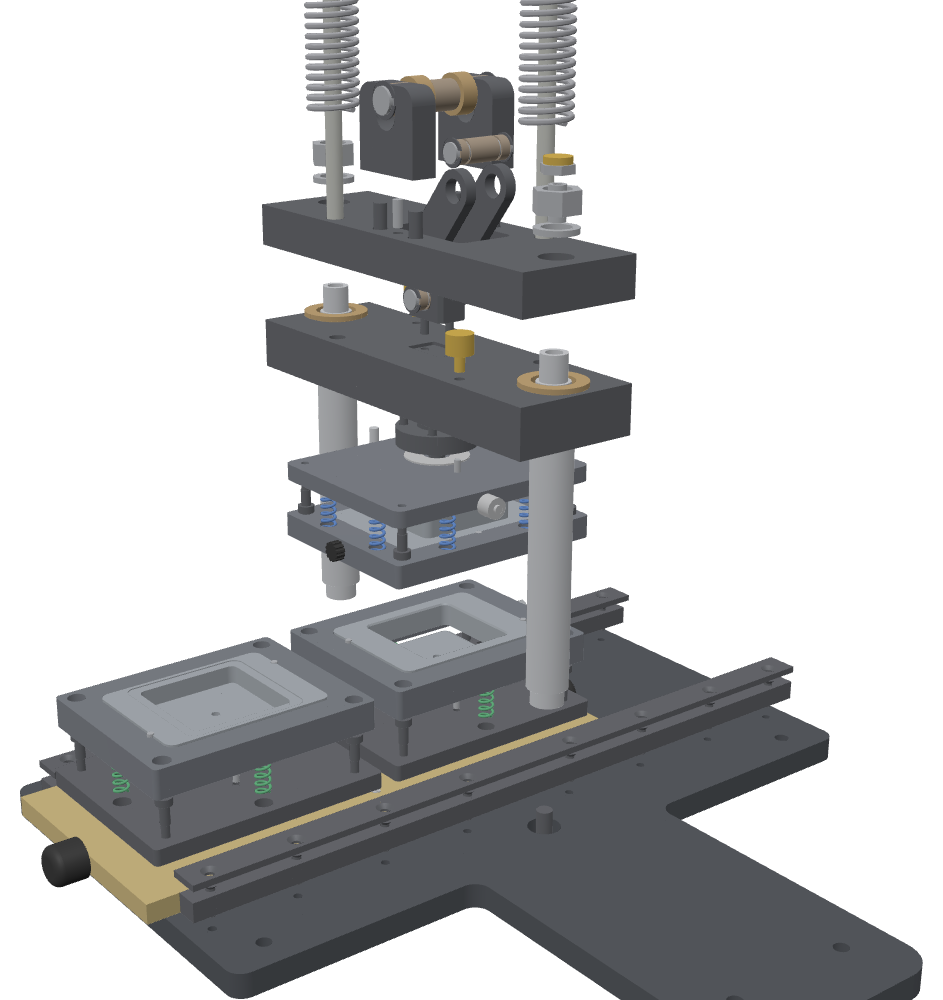

# MagPress M4 — 3D models (Rev C)

Every part of the press as its own 3D file: the 52 machined parts (including all four size kits) and the 48 bought parts from the BOM. They come in three formats, plus an assembly that shows how they fit together.

 

## What's here

| Path | Contents |
|---|---|
| [`step/`](step/) | One STEP file per part: exact solids that any CAD program can open and measure. |
| [`stl/`](stl/) | One STL per part, for 3D printing. |
| [`obj/`](obj/) | One OBJ per part, for viewers and rendering. |
| [`assembly/`](assembly/) | The whole press with every part in place, each a separate, named, coloured body: `MagPress-M4_assembly.step` (CAD), `.glb` (opens in Windows 3D Viewer, Blender and online viewers), `.obj` + `.mtl`. Also `interference.txt` (clash check, below) and the preview images. |
| [`parts.csv`](parts.csv) | The full list: part number, name, make or buy, group, quantity in the assembly, size, volume and file name. |
| [`build_models.py`](build_models.py) | The script that makes all of the above from the drawing source in `cad/`. |

**Names.** `MP-xxx` is the drawing number. Size-kit parts end in the size code: `5050` (50 × 50), `6363` (63.5 × 63.5), `5380` (53 × 80) and `6590` (65 × 90). `BUY-xx` is a bought part, named as in the BOM.

**Assembly pose.** The handle is up, station B is under the ram and kit 6363 is fitted. Units are mm. X runs along the die table, Z points up from the bench and the front of the press faces −Y. The other three kits are separate part files and are not placed.

**Part files** sit in their own frame, ready to print: plates lie flat, and turned parts stand on one end.

## Printing a visual model

- **Scale.** At 50% the whole press fits a 256 × 256 mm bed. The base plate is the largest part, at 230 × 235 mm. Print every part at the same scale so they still fit together.
- **Hole fit.** Holes and pins are modelled at their true nominal size, so printed pins won't go into printed holes. Use your slicer's hole compensation (+0.15 to +0.3 mm), or print pins and screws at 97–98%.
- **Die close-up.** The die alone is the most useful thing to print: the universal die plus one size kit. At full scale it fits a 220 mm bed, since the carriers are 144 × 116 mm.
- **Skip the small hardware.** At 50% the M4/M5 screws and Ø4 pins are about 2 mm across. Leave them out, or use real ones at full scale.
- **Springs** are modelled at their installed length (return spring 109.5 mm, die springs 30 and 26 mm), so they show where they sit. A printed spring is for looks only.

## Simplifications

- No threads. Threaded holes and studs are shown at the nominal thread diameter.
- No small chamfers or edge breaks. These are also left out: the plug's R1 working lip, the upper ring's 0.6 mm lead-in and the pickup ring's R0.5 edge.
- Bought parts are plain shapes at catalogue size, not supplier models.
- The size-kit plungers are shown for kit 6363.
- Not modelled: the optional bench screws and the foam kit case.

## Design problems found by the 3D check (Rev C)

`build_models.py` checks every pair of placed parts for overlap and every part for reaching below the bench. Everything fits except the items below (details in [`assembly/interference.txt`](assembly/interference.txt)). The models show the design as drawn. The drawings, BOM and build-pack page have **not** been changed yet.

| # | Problem | Suggested fix |
|---|---|---|
| 1 | **Toggle links hit the ram.** The links' R12 lower ends go round pin B, which is only 10 mm above the ram top, so they cut 2 mm into the ram on both sides of the clevis. | Mill two 3 mm deep clearance pockets in the ram top beside the clevis. This needs no change to heights or the toggle geometry. |
| 2 | **Pin B is wider than the crown slot.** The 40 mm pin sits up in the 38 mm slot with the handle up, so its ends overlap the crown by 1 mm each side. | Shorten pin B to 37.6 mm (the ring grooves stay where they are), or widen the crown slot to 42 mm. |
| 3 | **The push knobs drag on the base.** A Ø24 knob centred 6 mm above the table underside reaches 6 mm below the table, into the base plate. | Use a Ø12 knob on the end face, or a handle on the table top. |
| 4 | **The column clamp screws don't fit.** With the washer in, the M10 × 25 head hangs 6.5 mm below the base, past the 3 mm pads and into the bench. The screw is also longer than the 15 mm thread in the column. | Taller feet (about 10 mm) and a low-head M10 × 16 (DIN 7984), or a deeper counterbore in the base. |
| 5 | **No room for the handle stop.** The jam nut (5 mm) and urethane cap (4 mm) need 9 mm, but there is only 7 mm between the column nut and the lever at its 3° rest. The M10 × 1 × 20 screw is also longer than the 15 mm thread. | Use an M10 × 1 × 12 set screw with a nylon patch and no jam nut. |
| 6 | **The stop screw is too short.** The BOM's M6 × 0.75 × 25 can't reach through the 30 mm stop block to the table stop pin. | Use M6 × 0.75 × 40 (as modelled). |

## Rebuild

```sh
python3 -m venv .venv && .venv/bin/pip install cadquery trimesh
.venv/bin/python models/build_models.py           # writes into models/ (about a minute)
```
